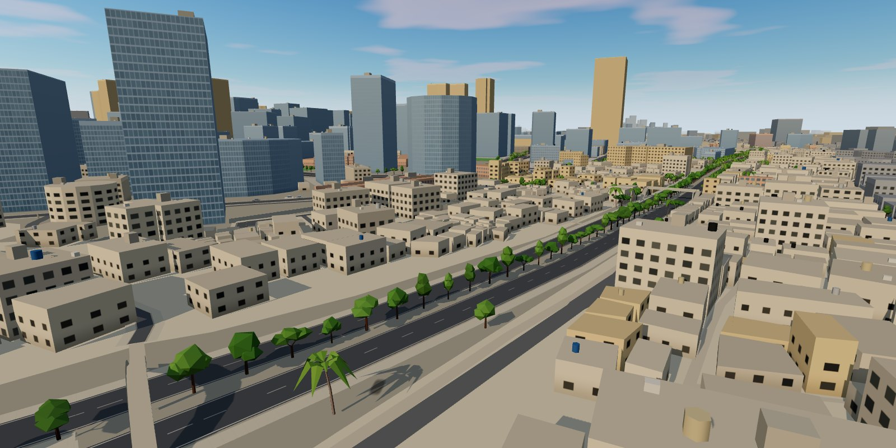

# Drive Thru MNL: No Traffic Edition?

[](https://github.com/ajs0905/drive-thru-mnl/actions/workflows/ci.yml)
[](LICENSE)
[](https://www.openstreetmap.org/copyright)

Real Metro Manila map data, streamed into the browser as a drivable 3D city. A Node pipeline turns raw OpenStreetMap exports into one compact map file; the browser builds the geometry, collision meshes and physics from it at load time. **Bonifacio Global City (BGC), Taguig** is the first district. The plan is to connect the districts around it and the highways between them, which is where browser geometry, streaming and physics budgets really get tested.


## Core Algorithms

**Computational geometry and mesh generation**
- Equirectangular projection, verified against Haversine distances: turns lat/long into local meters
- Sutherland-Hodgman polygon clipping and earcut triangulation: cuts footprints to the map, cuts building walls back off the roads, fills roofs, land use and road surfaces
- Polyline offsetting, mitred deck joints and convex-hull junction stitching: road ribbons, flyover decks without cracks, one polygon per junction
- Catmull-Rom splines: round the flyovers' and ramps' curves
- Contour tracing, Ramer-Douglas-Peucker simplification and a breadth-first distance transform: wall off empty lots at the back of the sidewalk
- Rotating calipers (minimum-area rectangles) and polygon scaling: hip roofs on houses and towers stepped back from their podiums
- Separating Axis Theorem (SAT) overlap tests: keep parked cars, roadblocks, street furniture and reset spots clear of obstacles

**Spatial indexing and graph algorithms**
- 2D spatial hash grids: fast "what's near this" lookups for every placement, footprint test and culling pass
- Union-find and road graph walks: merge nearby junctions of divided roads, follow roads through junctions
- Greedy graph coloring: give overlapping roads at interchanges a draw order, so nothing flickers
- Constrained placement search: pillars out of the lanes below, cars along the curbs, the nearest open road for a reset
- A directed road graph with Tarjan's strongly connected components, and routes by an edge-based A* with ALT landmark bounds: about 180 states expanded per route against Dijkstra's 1,450 (`npm run bench`)
- Deterministic headless simulation: golden replays of cargo runs driven by a pure-pursuit autopilot in the real physics, played back in CI (`npm run replay` records them)
- Traffic by the Intelligent Driver Model on the road graph, with junctions clustered by union-find and reserved one movement at a time, lanes fitted into the room parked cars leave, cubic Bézier curves through every junction (arc-length paced), a kinematic bicycle model on the path (the rear axle a tractrix of the front, the front wheels turning into every sideways move), lane changes in the spirit of MOBIL as quintic S-curves, exits picked on entering a roundabout, and fixed-time two-phase traffic lights per junction cluster that the cars queue at: about 85 µs per step for 24 cars, measured overlap-free in tests
- Evasive steering: the player's car projected to the moment it meets a traffic car decides which way that car dodges, left or right, checked for room and for anyone alongside or oncoming on that side
- Rule-based placement from road attributes: stop signs before unsignalized junctions with a bigger road, one-way signs facing the cross traffic, speed limits from `maxspeed` tags, kept clear of driveways, crossings and other furniture

**Rendering, physics and automated QA**
- Rasterization and flood fill: find unpaved holes in the road network, then pave them with the same detector
- GLSL shader injection: lane markings, zebras, windows and the car's Fresnel reflections from per-vertex data, no textures
- Ray-cast vehicle physics with slip-angle drift assists, and a collider-filtered ray that keeps the camera out of walls
- LRU tile caching for the minimap and big map, and view frustum and distance culling for the instanced props and cars
- Instanced traffic with wheels split off the merged models to spin and steer, bodies that lean on a spring, lit lamps, brake lights and turn signals, box cars past a distance by tier, and per-frame shadows cast from the sun's direction for anything moving
- Bumps as two-car collisions: a kinematic car hit by the player turns dynamic and gets the impulse of the hit at the contact point, so it's shoved and spun, then rejoins its lane once it settles

## Results & Benchmarks

| Metric | Value | Notes |
| :--- | :--- | :--- |
| **Build & Bundle** | | |
| Main / Drive bundle | 411 KB / 875 KB gzipped | The physics chunk (Rapier) loads only when you start driving; the font is bundled |
| Map file (`bgc.json`) | 3.35 MB (806 KB gzipped) | Deterministic: CI rebuilds it from the raw data and fails if a byte differs |
| First visit | About 2.4 MB compressed | Scripts, map, models and the menu picture; size budgets per chunk are checked in CI, and return visits re-download only what changed |
| Pipeline | 18 steps, a few seconds | Node + TypeScript, run at build time by the developer, never by players |
| **World Data** | | |
| Input | 25,930 OpenStreetMap features | A 19 MB GeoJSON export, plus 1,634 more for walls, trees and street fixtures |
| Output | 11,685 buildings, 3,536 roads, 1,384 junctions | Plus 511 zebras, 70 raised flyover and footbridge pieces on 279 pillars, 162 far-side traffic lights at 49 intersections, 1,195 street lights, 552 road signs (stop, one-way, speed limit), 938 trees, 51 walled-off lots, 2,731 pieces of street and lot furniture, 1,106 parked cars |
| Filled in by rules | 97% of building heights | OSM also has no bridge heights or ramps, no street parking and only outlines for empty lots |
| **Physics & Collision** | | |
| Collision meshes | 99k triangles, about 0.2 to 0.3 s to build | Walls and drivable decks built from the same data the renderer draws; street furniture is pooled bodies near the player instead (at most 28 knockable, 30 debris) |
| Fixed-step physics | 60 Hz | The same step function runs in the game and in headless tests |
| **Performance & Quality** | | |
| Frame rate (High) | 23 FPS to the 144 Hz screen limit | On the development laptop, after two measured passes ([PERFORMANCE.md](docs/PERFORMANCE.md)) |
| Frame rate (phones) | 60+ FPS on Low and Medium | On a low-mid range Android phone (30 to 50 on High); a newer mid-range one holds 62 on High |
| Draw calls | About 55 to 110 per view | The whole city, built in the browser in about 0.4 to 0.5 s; an idle view costs nothing |
| Automated tests | 773 unit and physics tests | Including an autopilot that drives up a real flyover ramp in Rapier |
| Map QA | 33 automated checks | A CI gate: counts can only go down |

## How It Works

1. **Build-time map pipeline** (`pipeline/`): run once by the developer whenever the map data or the rules change, not by players and not on a server. It compiles the raw OpenStreetMap GeoJSON export into one static, deterministic, versioned map file, `public/data/bgc.json`, which is checked into the repository (CI rebuilds it and fails if a single byte differs). On the way it works out building heights and forms, flyover heights and ramps, junction polygons, zebras, walls and lots, traffic lights, street lights, stop, one-way and speed limit signs, street furniture and parked cars, then runs 33 map QA checks.
2. **Static files in the browser**: the deployed game (on Vercel) is only static files on a CDN. There's no backend: opening the page downloads the scripts, the pre-built map file and a few 3D models, and the browser builds everything else from them. Hashed build files are cached for good, the map and models are re-checked on each visit, and every response carries strict security headers (`vercel.json`).
3. **Procedural 3D city** (`src/geometry/`, `src/scene/`): the browser builds road ribbons, flyover decks, buildings (hip-roofed houses, podium towers, shopfronts), trees and barriers from the map file, merged into 1.2 km grid cells, with GPU instancing for repeated props and GLSL shaders for markings, windows and car paint.
4. **Physics and vehicle** (`src/car/`): Rapier at a fixed 60 Hz, with arcade assists (slip-angle drift control, anti-spin, a hysteresis gearbox) and camera ray clipping. Parked cars, roadblock pieces and street furniture become physics bodies only near the player, from capped pools, so you can knock over lamp posts and smash through waiting sheds without the whole map in the physics world. The car code doesn't touch React or three.js, so the same step function runs in headless Vitest suites. A car that goes somewhere it can't be (off the map, or numbers the physics lost) is put back where it last was fine.
5. **Game systems** (`src/routing/`, `src/traffic/`, `src/game/`): a directed road graph with A* routes for the cargo runs and the GPS line; traffic simulated in plain TypeScript (car following, junction reservations, signals, lane changes, dodging) and only drawn and given physics bodies near the player; the game session (runs, pay, wallet, cars) saved in the browser and read back through a validator, so a damaged or edited save can't break the game.
6. **Render on demand, adaptive quality**: frames are drawn only when something changes, shadows re-render on a throttle, the pixel ratio follows the frame rate, and the 2D maps paste cached tiles. Low, Medium and High tiers aim at desktops and low-mid range Android phones. If the graphics are lost (a driver reset, a phone reclaiming memory), the game pauses and recovers when the browser restores them.




## The game

Free-roam arcade driving on BGC's real streets, with less traffic than the real thing (hence the name, and the question mark). Drift the corners, take the flyovers, send the roadblocks at the edge flying. Take cargo runs between curbside loading bays and landmarks for pesos: on time and without denting the cargo, with a GPS route on the minimap and the full map, and a delivery receipt at the end. Traffic drives the avenues and streets, changing lanes and working its way round the circles, and you can bump it into a spin. Police chases are next. Runs in the browser on desktops and phones, nothing to install.

**Controls:** W A S D or the arrow keys to drive, Space for the handbrake, R to reset the car, M for the map, Esc to pause, MODES / CARS at the top right. On a phone, hold it sideways and use the buttons on screen.

## What's built

- Map pipeline: OSM export to one compact, deterministic map file at build time, with heights, building forms, flyovers, junctions, crossings, trees, walls, walled-off lots, mast-arm and pole traffic lights, street lights, road signs, street furniture and parked cars worked out by rule
- Map QA: 33 checks run in CI, each with a baseline that can only go down
- 3D city: buildings with windows, shopfronts, hip roofs, podium towers and roof details, painted roads with clean intersections, a physically based sky, shadows, and filler city and real skylines past the edge
- Performance: three quality tiers, adaptive resolution, grid culling, render on demand, reversed depth
- Driving: Rapier physics with arcade handling (drift assist, speed-sensitive steering), a chase camera, solid buildings, drivable flyovers, walled-off lots, street furniture and signs you can knock over, waiting sheds you can smash through, parked cars and roadblocks you can push around, and a reset to the nearest open road
- UI: a road sign menu, loading screens, a how-to-play card with the keyboard or touch controls (whichever you have), a road sign HUD with a heading-up minimap and a full map with the area's name, a pause menu (also when you leave the tab), touch controls for phones; the drive turns sideways on an upright phone, menus and cards fit a landscape phone without scrolling, and stay light when a phone forces dark mode
- Modes: cargo runs (courier and vault) between curbside loading bays and landmarks, routed by A* with landmarks, with checkpoints, a cargo integrity rating, an itemized delivery receipt (base and distance fee, integrity bonus, 12% VAT and 5% withholding tax) and a peso wallet saved in the browser; a CARS tab with pictures drawn from the models and prices to save up for
- Traffic on the avenues and streets: 24 to 40 cars around the player by quality tier, steering and leaning like cars, changing lanes with the signal on, finding their way off roundabouts, easing round stopped cars, stopping at red lights (you don't have to), braking and steering out of your way, left or right, when you come at them fast, and getting shoved aside when you bump them before getting back in line
- Traffic lights that cycle with lit lenses, and stop, one-way and speed limit signs along the streets, all of which you can knock over
- Hosting-ready: static build with size budgets checked in CI, a content security policy and other security headers, caching that never strands a player on old files, and no third-party scripts, fonts or CDNs

## Planned

- First deploy on Vercel (the config is in the repo), with a live link here
- Modes: Kamote Mode (police chases), and the van, muscle car, coupe and police cars from the vehicle pack
- Rapier's build with a separate WebAssembly file (about 220 KB smaller to download)
- Utility poles and more building detail (balconies, materials, signage)
- Later: engine, tire and crash sounds, ambience and music
- Tile streaming, then more of Metro Manila: the districts around BGC and the highways between them

## Known issues and fixes

- 3 ramps still overlap a road running alongside them (map QA `ramp-in-lanes`); needs per-ramp width fitting
- Underpasses are drawn at ground level
- Zebras are always square to the road, and there are no stop lines or lane arrows yet
- About 40 driveways and access roads still run into malls, towers and car parks as mapped (map QA counts)
- 27 small unpaved gaps between roads are left as islands (map QA `paving-hole`)
- Windows assume 3.2 m floors on every building, and it's always daytime
- The whole city sits on the GPU at once; tile streaming (planned) is what lets the map grow

## Getting started

Requires Node 22 or newer.

```bash
npm install
npm run dev
```

The BGC map data is already in the repo, so that's all you need.

| Command | What it does |
| --- | --- |
| `npm run dev` | Start the game locally (add `?q=low`, `?q=medium` or `?q=high` to the URL to force a quality tier, `?debug` for the frame rate, `?view=map` for the free camera map view that map QA's links open) |
| `npm test` | Unit tests |
| `npm run pipeline` | Rebuild `public/data/bgc.json` from the raw export |
| `npm run qa` | Scan the map for known problems, with camera links |
| `npm run size` | Production build, with each chunk's gzipped size checked against its budget |
| `npm run check` | Everything CI runs: typecheck, lint, tests, data in sync, QA gate, build size |

## Docs

- [Architecture](docs/ARCHITECTURE.md): how it's built, module boundaries, data contract, rendering, quality tiers, testing, roadmap
- [Map data](docs/DATA.md): sources, refreshing the data, each pipeline step with its numbers, building heights, map QA
- [Performance](docs/PERFORMANCE.md): budgets per quality tier, measured numbers, how to profile on a phone
- [Decisions](docs/decisions/): one page per big decision and its trade-offs

## Stack

- Three.js via React Three Fiber, TypeScript, Vite
- Rapier physics via `@react-three/rapier`, loaded on demand
- Node + TypeScript data pipeline (`pipeline/`)
- Vitest, oxlint, GitHub Actions

## Credits and license

- Code: [MIT](LICENSE), Adrian Joseph B. Salva
- Map data © [OpenStreetMap contributors](https://www.openstreetmap.org/copyright), available under the Open Database License (ODbL)
- Polygon triangulation: [earcut](https://github.com/mapbox/earcut)
- Cars: the Sedan you drive and six parked models from the [Free Low Poly Vehicles Pack](https://rgsdev.itch.io/free-low-poly-vehicles-pack) by Rgsdev (CC0), converted with `tools/car-to-glb.ts` and `tools/parked-cars-to-glb.ts`
- Traffic cone and concrete barrier: [City Kit Roads](https://kenney.nl/assets/city-kit-roads) by Kenney (CC0), baked with `tools/kenney-to-ts.ts`
- Dumpster, work light, traffic light heads, planter and kiosk awning: [City Kit Roads](https://kenney.nl/assets/city-kit-roads), [City Kit Suburban](https://kenney.nl/assets/city-kit-suburban) and [City Kit Commercial](https://kenney.nl/assets/city-kit-commercial) by Kenney (CC0), merged with the props built in code into `public/models/props.glb` by `tools/props-to-glb.ts`
- Font: [Overpass](https://github.com/RedHatOfficial/Overpass) by The Overpass Project Authors (SIL Open Font License 1.1), bundled through [Fontsource](https://fontsource.org/fonts/overpass)
