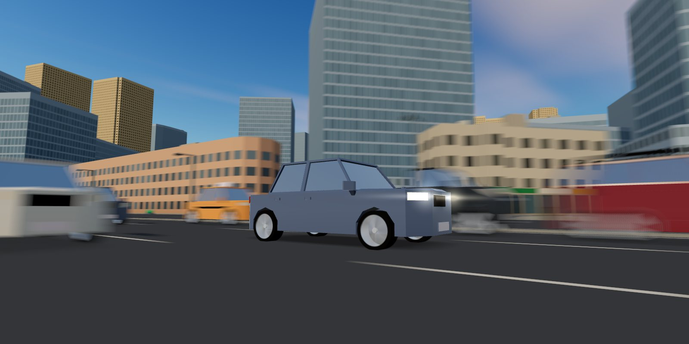
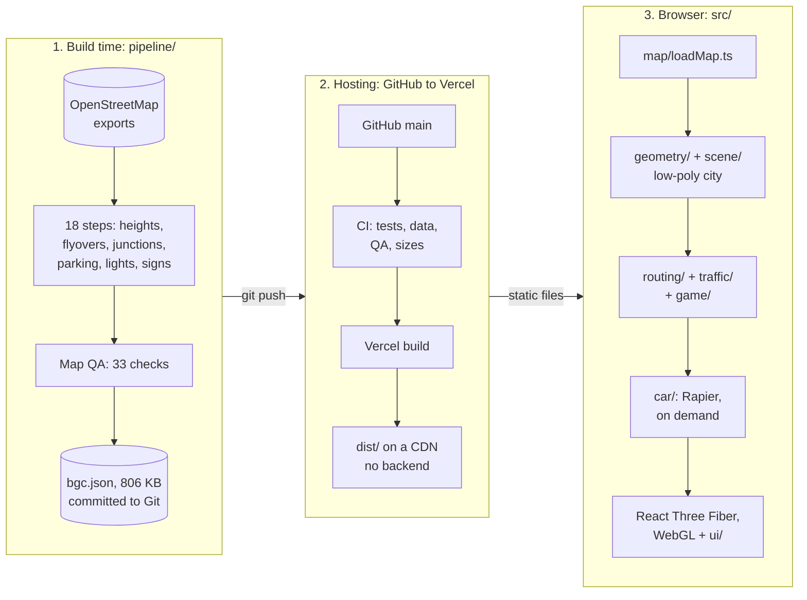

# Drive Thru MNL: No Traffic Edition?

[](https://drive-thru-mnl.vercel.app/)
[](https://github.com/ajs0905/drive-thru-mnl/actions/workflows/ci.yml)
[](LICENSE)
[](https://www.openstreetmap.org/copyright)

Real Metro Manila map data, streamed into the browser as a drivable low-poly 3D city. A build-time Node pipeline turns raw OpenStreetMap exports into one compact static map file; the browser builds the low-poly geometry, collision meshes and physics from it at load time. **Bonifacio Global City (BGC), Taguig** is the first district. The plan is to connect the districts around it and the highways between them, which is where browser geometry, streaming and physics budgets really get tested.

**[Play live](https://drive-thru-mnl.vercel.app/)** · [Architecture](docs/ARCHITECTURE.md) · [Map pipeline & data](docs/DATA.md) · [Controls & modes](docs/PLAYING.md) · [All docs](docs/README.md)



## The game

Free-roam low-poly arcade driving across Metro Manila's real streets, starting in BGC, Taguig. Runs straight in the browser on desktop and mobile with nothing to install.

- **Explore the city:** Drive around a 3D city generated from OpenStreetMap data.

- **Cargo runs:** Pick up deliveries between areas around the city using GPS routing, keep the cargo intact, and earn peso payouts (with tax included, of course).

- **Traffic & mobile support:** Share the road with roaming traffic, or play on your phone with touch controls and automatic landscape mode.

W A S D or the arrow keys to drive, Space for the handbrake, R to reset, M for the map, Esc to pause; Touch controls for mobile are supported as well. All controls, the modes and the testing options: [Controls & modes](docs/PLAYING.md).

## Algorithms

What each algorithm is used for. Where they run and their numbers: [Algorithms](docs/ALGORITHMS.md).

**Map geometry and meshes** (build-time pipeline and `src/geometry/`)

| Algorithm | Used for |
| :--- | :--- |
| Equirectangular projection, checked against Haversine | Turning latitude and longitude into local meters |
| Sutherland-Hodgman polygon clipping | Cutting buildings and land to the map, and building walls back off the roads |
| Earcut triangulation | Filling roofs, land use, road surfaces and junctions |
| Extrusion and rotating calipers (minimum-area rectangles) | Low-poly buildings with hip roofs and towers stepped back from their podiums |
| Polyline offsetting and convex hulls | Road ribbons, crack-free flyover decks and 1,384 junction polygons |
| Catmull-Rom splines | Rounding the curves of flyovers and ramps |
| Contour tracing, Ramer-Douglas-Peucker and a BFS distance transform | Walling off empty lots at the back of the sidewalk |
| Separating Axis Theorem (SAT) | Keeping parked cars, roadblocks, street furniture and reset spots clear of obstacles |

**Spatial indexing and routing**

| Algorithm | Used for |
| :--- | :--- |
| 2D spatial hash grids | Fast "what's near here" lookups for placement, physics pools and culling |
| Union-find | Merging the junctions of divided roads, and clustering junctions for traffic lights and traffic |
| Greedy graph coloring | A draw order for overlapping roads at interchanges, so nothing flickers |
| Tarjan's strongly connected components | Finding the drivable road network (1,706 nodes, 3,062 directed edges) |
| A\* with ALT landmarks | Cargo run routes and the GPS line: 179 states searched per route, against Dijkstra's 1,447 |

**Traffic** (`src/traffic/`)

| Algorithm | Used for |
| :--- | :--- |
| Intelligent Driver Model | Following the car ahead and stopping at red lights |
| Junction reservations and fixed-time signal phases | Crossing junctions without passing through each other, on green |
| Kinematic bicycle model on Bézier curves | Steering along lanes and through junctions like a real car |
| MOBIL-style lane changes as quintic S-curves | Changing lanes, signal on, when there's a gap |
| Collision prediction | Dodging the player, to the side with room |

**Physics** (`src/car/`, Rapier at a fixed 60 Hz)

| Algorithm | Used for |
| :--- | :--- |
| Ray-cast vehicle with slip-angle drift control | The car's arcade handling: drifts, anti-spin, automatic gears |
| Static triangle meshes from the map | Solid buildings, walls and drivable flyover decks (98,615 triangles) |
| Impulse at the contact point | Bumping traffic cars into a spin |
| Filtered ray casting | Keeping the chase camera out of walls |

**Rendering** (`src/scene/`)

| Algorithm | Used for |
| :--- | :--- |
| Merged grid cells and GPU instancing | Drawing the city, props and cars in few draw calls |
| Frustum and distance culling | Drawing only the props, parked cars, traffic and lamps in view and in range |
| GLSL shaders from per-vertex data | Lane markings, zebras, windows and car reflections without textures |
| Render on demand and adaptive resolution | Keeping the frame rate up on phones, and nothing drawn when nothing changes |

**QA and testing**

| Algorithm | Used for |
| :--- | :--- |
| Rasterization and flood fill | Finding unpaved holes in the road network, then paving them |
| 33 deterministic map QA checks | Catching map problems in CI (counts can only go down) |
| Deterministic replays with a pure-pursuit autopilot | Golden cargo runs replayed in the real physics in CI |

## Results & Benchmarks

**Build and payload**

| Metric | Value | Notes |
| :--- | :--- | :--- |
| Main chunk | 412 KB gzipped | three.js, React, the menus and the city builder; budget 430 kB, checked in CI |
| Drive chunk | 875 KB gzipped | Rapier physics, loaded only when you start driving |
| Map file (`bgc.json`) | 3.35 MB, 806 KB gzipped | Rebuilt byte for byte in CI |
| First visit | About 2.4 MB compressed | Scripts, map, models and the menu picture; return visits re-download only what changed |
| Pipeline | 18 steps, under 15 s | Node + TypeScript, run by the developer, never by players |

**World data**

| Metric | Value | Notes |
| :--- | :--- | :--- |
| Input | 25,930 OpenStreetMap features | A 19 MB GeoJSON export, plus 1,634 more for walls, trees and street fixtures |
| Buildings | 11,685 | 6,354 drivable around, 5,331 scenery; heights filled in by rule for 97% |
| Roads | 3,536 ways, 13,992 shape points | 1,384 junction polygons, 511 zebras, 70 raised flyover and footbridge pieces on 279 pillars |
| Road graph | 1,706 nodes, 3,062 directed edges | Built in the browser in about 0.1 s |
| Placed by rule | 1,106 parked cars, 1,195 street lights, 552 road signs | Plus 162 far-side traffic lights at 49 intersections, 938 trees, 2,731 pieces of street and lot furniture |
| Collision meshes | 98,615 triangles | 64k walls and 35k drivable decks and posts, built when driving starts |

**Runtime frame budget and scale**

| Metric | Value | Notes |
| :--- | :--- | :--- |
| Frame rate targets | Low 30, Medium 45 to 60, High 60 FPS | Budgets per tier in [Performance](docs/PERFORMANCE.md) |
| Desktop | 144 FPS on High (the screen's limit) | Development laptop; 23 FPS before two measured performance passes |
| Phones | 60+ FPS on Low and Medium | A low-mid range Android phone (30 to 50 on High); a newer mid-range one holds 62 on High |
| Draw calls / triangles | Low 73 to 77 / 250k, Medium 78 to 122 / 300k to 506k, High 84 to 124 / 328k to 537k | Driving from the start spot with traffic, 1280 x 720 |
| City build in the browser | About 0.4 to 0.7 s | 428 to 695 ms on the two phones |
| Physics | Fixed 60 Hz | 36k to 60k steps a second headless with the map's collision |
| Traffic | 24 / 32 / 40 cars by tier | About 0.1 to 0.15 ms per simulation step, no overlaps in five simulated minutes |
| Physics pools | Parked cars within 70 m, 28 knockable props within 35 m, 30 debris pieces | Only what's near the player is a body |

**Tests and QA**

| Metric | Value | Notes |
| :--- | :--- | :--- |
| Automated tests | 795 unit and physics tests | Including an autopilot that drives up a real flyover ramp in Rapier |
| Map QA | 33 checks | A CI gate: counts can only go down |
| Golden replays | 3 cargo runs | Played back in the real physics in CI, must end within 5 cm |

Measured with `npm run size`, `npm run bench`, the pipeline's output and the `?debug` overlay; details and dates in [Performance](docs/PERFORMANCE.md).

| | | |
| :---: | :---: | :---: |
|  |  |  |
| Flyovers raised from OSM bridge tags | Junctions, lights and parking by rule | Low-poly building forms |

## Architecture



- **Build time:** the expensive, careful work (projection, cleanup, heights, flyovers, placement by rule) happens once on the developer's machine. The output is deterministic: CI rebuilds the map and fails if a single byte differs, and map QA counts can only go down.
- **Hosting:** only static files. Hashed scripts are cached for good, the map and models are re-checked on each visit, every response carries strict security headers, and visits are counted without cookies through the site's own address.
- **Browser:** the city is built from the map file in about half a second, merged into grid cells and drawn on demand. Physics loads only when you start driving, and only what's near the player becomes a physics body.

More: [Architecture](docs/ARCHITECTURE.md) (module boundaries, data contract, rendering, testing) and [Decisions](docs/decisions/) (32 records).

## Known issues

- **Road markings:** lane markings at complex junctions and slip lanes don't line up cleanly yet; zebras are always square to the road, and there are no stop lines or lane arrows.
- **Flyover ramps:** some slopes change abruptly at speed, 3 ramps overlap a road running alongside them (map QA `ramp-in-lanes`), and underpasses are drawn at ground level.
- **Roaming traffic:** steering, lane changes and dodging still look unnatural at times, around tight corners and roundabouts most of all; a car spun far off its lane leaves instead of rejoining, and far box cars pop into full models as they come near.
- **Map data:** about 40 driveways and access roads run into malls, towers and car parks as mapped, 27 small unpaved gaps between roads are left as islands, and building heights are estimates for 97% of buildings.
- **Phones:** the Low tier draws more than its budget since traffic, signals and signs arrived, and High is a desktop tier (30 to 50 FPS on a low-mid range phone).
- **One district:** the whole city sits on the GPU at once, and the drivable area ends at roadblocks around BGC; tile streaming is what lets the map grow.
- **Not there yet:** sound, night time and the cars other than the Sedan; windows assume 3.2 m floors on every building.

## Planned

- **Next district:** Makati CBD and Ayala, joined to BGC by the roads between them (Kalayaan Avenue, EDSA), with tile streaming so phones only load what's near
- **Kamote Mode (police pursuit):** TBD
- **More modes:** TBD
- **Environment:** more building variety, cleaner road markings (stop lines, arrows, diagonal zebras), smoother flyover ramps, fixes for the remaining road errors, and landmarks at street level
- **More natural traffic:** smoother multi-lane flow, yielding at junctions, and better reactions to other cars and to you
- **More roaming traffic:** more cars, and traffic on the roads that don't have any yet
- **Time of day and weather:** afternoon, night (headlights, lit windows, street lights) and rain
- **Car modifications and upgrades:** the Cargo Van, Muscle Car and Sports Coupe, plus tuning parts, handling setups and looks, bought with the pesos you earn
- **Music and sound:** engine and exhaust, tire screech, crashes, UI sounds and etc.
- **More optimization:** tile streaming, building the city in a Web Worker, binary map data, far-detail reduction, and Rapier's separate WebAssembly build (about 220 KB smaller)

## Contributing

Issues and pull requests are welcome: bug reports with a screenshot and the `?cam=` part of the address, road errors you spot on the map, ideas for the planned list.

**Run it locally** (Node 22.15 or newer, any current LTS):

```bash
npm install
npm run dev     # the game at http://localhost:5173
npm test        # unit and physics tests
npm run check   # everything CI runs, before you open a pull request
```

The BGC map data is already in the repo, so that's all you need to play and work on the game.

| Command | What it does |
| --- | --- |
| `npm run dev` | Start the game locally (`?q=low` / `medium` / `high`, `?debug`, `?view=map`: see [testing options](docs/PLAYING.md#options-for-testing)) |
| `npm test` | Unit and physics tests |
| `npm run pipeline` | Rebuild `public/data/bgc.json` from the raw export (same as `npx tsx pipeline/build.ts`) |
| `npm run qa` | Scan the map for known problems, with camera links |
| `npm run bench` | Routing, physics and traffic benchmarks |
| `npm run replay` | Record the golden replays again (only when a physics or map change is meant to change them) |
| `npm run size` | Production build, with each chunk's gzipped size checked against its budget |
| `npm run check` | Everything CI runs: typecheck, lint, tests, data in sync, QA gate, build size |

**Changing the map:** edit the steps in `pipeline/`, run `npm run pipeline`, and commit `public/data/bgc.json` with your change (CI fails until the committed file matches what the pipeline builds). If a fix lowers a map QA count, lower it in `data/qa-baseline.json` too; a count that rises fails CI. Each step and its numbers are in [Map pipeline & data](docs/DATA.md).

**Pull requests:** keep them focused, with tests for new behavior and `npm run check` passing. Module boundaries (for example, no three.js or React in `src/car` and `src/traffic`) are enforced by `tests/architecture.test.ts`; see [Architecture](docs/ARCHITECTURE.md#3-repository-layout-and-module-boundaries). For a big change, open an issue first so it can be talked through.

## Stack

Three.js via React Three Fiber, TypeScript and Vite; Rapier physics via `@react-three/rapier`, loaded on demand; a Node + TypeScript data pipeline; Vitest, oxlint and GitHub Actions; hosted on Vercel.

## License and credits

- Code: **MIT License**, see [LICENSE](LICENSE)
- Map data © [OpenStreetMap contributors](https://www.openstreetmap.org/copyright), available under the Open Database License (ODbL); the processed map in `public/data/` is a derived database under the same license
- Polygon triangulation: [earcut](https://github.com/mapbox/earcut)
- Cars: the Sedan you drive and six parked models from the [Free Low Poly Vehicles Pack](https://rgsdev.itch.io/free-low-poly-vehicles-pack) by Rgsdev (CC0), converted with `tools/car-to-glb.ts` and `tools/parked-cars-to-glb.ts`
- Traffic cone and concrete barrier: [City Kit Roads](https://kenney.nl/assets/city-kit-roads) by Kenney (CC0), baked with `tools/kenney-to-ts.ts`
- Dumpster, work light, traffic light heads, planter and kiosk awning: [City Kit Roads](https://kenney.nl/assets/city-kit-roads), [City Kit Suburban](https://kenney.nl/assets/city-kit-suburban) and [City Kit Commercial](https://kenney.nl/assets/city-kit-commercial) by Kenney (CC0), merged with the props built in code into `public/models/props.glb` by `tools/props-to-glb.ts`
- Font: [Overpass](https://github.com/RedHatOfficial/Overpass) by The Overpass Project Authors (SIL Open Font License 1.1), bundled through [Fontsource](https://fontsource.org/fonts/overpass)
