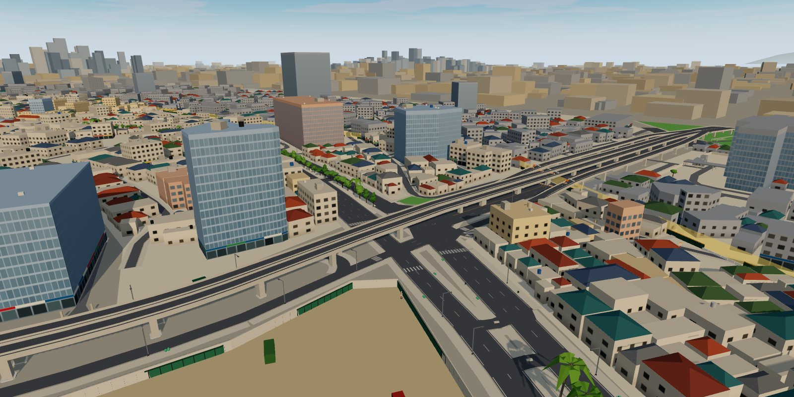
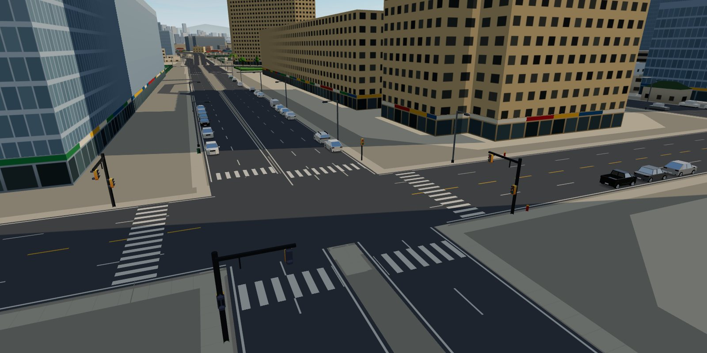

# Drive Thru MNL: No Traffic Edition?

[](https://github.com/ajs0905/drive-thru-mnl/actions/workflows/ci.yml)
[](LICENSE)
[](https://www.openstreetmap.org/copyright)

Real Metro Manila map data, streamed into the browser as a drivable 3D city. A Node pipeline turns raw OpenStreetMap exports into one compact map file; the browser builds the geometry, collision meshes and physics from it at load time. **Bonifacio Global City (BGC), Taguig** is the first district. The plan is to connect the districts around it and the highways between them, which is where browser geometry, streaming and physics budgets really get tested.


## Results

| | |
| --- | --- |
| **Input** | 25,930 OpenStreetMap features (a 19 MB GeoJSON export), plus 1,634 more for walls, trees and street fixtures |
| **Output** | 11,687 buildings, 3,536 roads, 1,384 junction polygons, 511 zebra crossings, 70 raised flyover and footbridge pieces on 279 pillars, 938 trees, 51 walled-off lots, 2,876 pieces of street and lot furniture, 1,106 parked cars: one 766 KB (gzipped) file |
| **Missing data, filled by rules** | 97% of buildings have no height in OSM, bridges have no height or ramps, street parking isn't mapped, and empty lots are just outlines that run onto the streets. All of it is worked out by the pipeline |
| **Pipeline** | 16 steps, a few seconds, deterministic: CI rebuilds the map and fails if the output differs by a byte |
| **Map QA** | 25 kinds of map problem scanned on every push, with counts that can only go down. Examples: 758 flickering road overlaps, 226 trees standing on roads and 55 pillars in the lanes below them, all now 0 |
| **Rendering** | The whole city in about 55 to 105 draw calls, built in the browser in about 300 to 400 ms; an idle view costs nothing |
| **Performance work** | High on the development laptop went from 23 FPS to the screen's 144 Hz limit after two measured passes |
| **Physics** | Collision meshes (113k triangles) built from the map data when you start driving, matching exactly what's drawn; the flyovers are drivable |
| **Tests** | 619 unit tests, including the car's handling run in the real physics engine and an autopilot that drives up a real flyover ramp |
| **Download** | 383 KB (gzipped) to see the city; the 859 KB physics chunk loads only when you start driving |

## Algorithms and techniques

| | Where |
| --- | --- |
| Equirectangular projection (lat/long to local meters), tested against haversine distances | `src/geo/projection.ts` |
| Polygon clipping (Sutherland-Hodgman) and earcut triangulation for footprints, land use and road surfaces | `src/geometry/polygon.ts`, `extrude.ts` |
| Spatial hashing (uniform grids of points and segments) for every "what's near this" query in the pipeline, the map and the street lookup | `src/geometry/spatialGrid.ts` |
| Road graph with union-find to merge nearby junctions, and graph walks along roads | `pipeline/junctions.ts` |
| Junction polygons built from where the road edges meet, with a fallback when they don't | `src/geometry/junction.ts` |
| Rasterization plus flood fill to find unpaved holes between roads, then the same detector reused to pave them | `pipeline/paving.ts`, `pipeline/qaRoads.ts` |
| Rasterized free land, a breadth-first distance transform, contour tracing and Ramer-Douglas-Peucker simplification to wall off empty lots at the back of the sidewalk | `pipeline/lots.ts`, `src/geometry/polygon.ts` |
| Separating axis tests for placement (parked cars, roadblocks, street furniture), ray casts to keep the chase camera out of walls | `pipeline/parking.ts`, `src/geometry/roadblocks.ts`, `src/car/chaseCamera.ts` |
| Catmull-Rom splines to round flyovers and ramps, constrained search to place pillars out of the lanes below | `pipeline/smoothRaised.ts`, `pipeline/structures.ts` |
| Greedy graph coloring to give overlapping roads a draw order (no flicker) | `pipeline/roadLayers.ts` |
| GLSL shaders for lane markings, zebras, windows and car paint reflections, all from per-vertex data with no textures | `src/scene/` |
| GPU instancing, distance and view culling, render on demand, adaptive resolution, cached 2D map tiles | `src/scene/`, `src/ui/mapTiles.ts` |
| A deterministic pipeline and a map QA gate in CI: the map is rebuilt on every push and problem counts can only go down | `pipeline/qa.ts`, `.github/workflows/ci.yml` |

## How it works

- **Messy data, handled.** Only 3% of buildings have a height in OSM, so heights are estimated from type and footprint. Indoor walkways, basements and skywalks mapped through malls are cleaned up, buildings hidden inside other buildings (duplicates, old construction site outlines) are removed, and roads are narrowed to fit between the houses along them.
- **Flyovers worked out from tags.** OSM only says "bridge, layer 1". The pipeline decides which bridges are really raised (only those crossing a road), builds ramps on the approach roads that stop at junctions and never climb inside another road's lanes, rounds their curves with splines, and places pillars where they don't block a lane below (sliding along the deck, into an avenue's median, or onto an outrigger pier).
- **Clean intersections, painted roads.** Roads are split into a graph and every junction gets its own polygon, worked out from where the road edges meet; leftover gaps are found by rasterizing the road surface and paved. Lane lines, zebra crossings and curbs are drawn by a shader from per-vertex data: no textures, no extra draw calls.
- **Windows without textures.** Every building gets windows from its type and height (glass towers, offices, apartments, houses, parking decks), drawn by a shader; roofs get stair housings, AC units and water tanks.
- **Walls and trees that respect the streets.** Walls and fences from OSM are cut open wherever a road passes, street trees mapped into the road are moved to the curb, gates and parking booms turn to span their road. Trees are low-poly models built in code and drawn as GPU instances.
- **Streets that hold you.** Most empty lots (construction sites, vacant blocks, gardens) are closed off at the back of the sidewalk with hoarding, lot walls or hedges, traced from the free land so they never stand on a street; footpaths into them get bollards. Three places are left open on purpose: a park, a sports field and a surface parking yard with its stalls and cars. Waiting sheds, planters, bins and hydrants line the sidewalks, and they're solid.
- **Parked cars placed by rule.** Only on streets wide enough to still drive past, clear of junctions, crossings, driveways and trees, in stretches with gaps. Two levels of detail plus distance and view culling; near the player they're physics bodies, and a car you knock out of place goes back to its spot once it's off screen.
- **Scales with the device.** Low, Medium and High tiers plus a resolution that adapts to the frame rate. Shadows, MSAA, tree models and the speed blur are switched by tier; the map and the handling never are.
- **No edge of the world.** Past the mapped area the city continues as filler blocks out to the haze, with the real skylines of Makati and Ortigas where they actually are. Where the drivable area ends, roads are closed off by roadblocks (concrete barriers, a "road under construction" sign, and barricades, drums and cones you can send flying) and a construction fence runs between them.






## The game

Free-roam arcade driving on BGC's real streets, for once without the traffic (hence the name). Drift the corners, take the flyovers, send the roadblocks at the edge flying. Checkpoint races, ride-hailing and police chases are next. Runs in the browser on desktops and phones, nothing to install.

**Controls:** W A S D or the arrow keys to drive, Space for the handbrake, R to reset the car, M for the map, Esc to pause. On a phone, hold it sideways and use the buttons on screen.

## What's built

- Map pipeline: OSM export to one compact, deterministic map file, with heights, flyovers, junctions, crossings, trees, walls, walled-off lots, street furniture and parked cars worked out by rule
- Map QA: 25 checks run in CI, each with a baseline that can only go down
- 3D city: buildings with windows and roof details, painted roads with clean intersections, a physically based sky, shadows, and filler city and real skylines past the edge
- Performance: three quality tiers, adaptive resolution, grid culling, render on demand, reversed depth
- Driving: Rapier physics with arcade handling (drift assist, speed-sensitive steering), a chase camera, solid buildings, drivable flyovers, walled-off lots and solid street furniture, parked cars and roadblocks you can push around
- UI: a road sign menu, loading screens, a road sign HUD with a heading-up minimap and a full map, a pause menu, touch controls for phones

## Planned

- Measure it on a phone, then street lights and traffic lights, utility poles, better buildings and sounds
- First deploy on Vercel
- Game modes: sprint from A to B, ride-hailing, light traffic, a police chase
- Tile streaming, then more of Metro Manila: the districts around BGC and the highways between them

## Known issues and fixes

- 3 ramps still overlap a road running alongside them (map QA `ramp-in-lanes`); needs per-ramp width fitting
- Underpasses are drawn at ground level
- Zebras are always square to the road, and there are no stop lines or lane arrows yet
- A few dozen houses poke into alleys and service roads (map QA counts), so some alleys may be blocked
- 27 small unpaved gaps between roads are left as islands (map QA `paving-hole`)
- Windows assume 3.2 m floors on every building, and it's always daytime
- The whole city sits on the GPU at once; tile streaming (planned) is what lets the map grow

## Getting started

Requires Node 22 or newer.

```bash
npm install
npm run dev
```

The BGC map data is already in the repo, so that's all you need.

| Command | What it does |
| --- | --- |
| `npm run dev` | Start the game locally (add `?q=low`, `?q=medium` or `?q=high` to the URL to force a quality tier, `?debug` for the frame rate, `?view=map` for the free camera map view that map QA's links open) |
| `npm test` | Unit tests |
| `npm run pipeline` | Rebuild `public/data/bgc.json` from the raw export |
| `npm run qa` | Scan the map for known problems, with camera links |
| `npm run check` | Everything CI runs: typecheck, lint, tests, data in sync, QA gate |

## Docs

- [Architecture](docs/ARCHITECTURE.md): how it's built, module boundaries, data contract, rendering, quality tiers, testing, roadmap
- [Map data](docs/DATA.md): sources, refreshing the data, each pipeline step with its numbers, building heights, map QA
- [Performance](docs/PERFORMANCE.md): budgets per quality tier, measured numbers, how to profile on a phone
- [Decisions](docs/decisions/): one page per big decision and its trade-offs

## Stack

- Three.js via React Three Fiber, TypeScript, Vite
- Rapier physics via `@react-three/rapier`, loaded on demand
- Node + TypeScript data pipeline (`pipeline/`)
- Vitest, oxlint, GitHub Actions

## Credits and license

- Code: [MIT](LICENSE), Adrian Joseph B. Salva
- Map data © [OpenStreetMap contributors](https://www.openstreetmap.org/copyright), available under the Open Database License (ODbL)
- Polygon triangulation: [earcut](https://github.com/mapbox/earcut)
- Cars: the Sedan you drive and six parked models from the [Free Low Poly Vehicles Pack](https://rgsdev.itch.io/free-low-poly-vehicles-pack) by Rgsdev (CC0), converted with `tools/car-to-glb.ts` and `tools/parked-cars-to-glb.ts`
- Traffic cone and concrete barrier: [City Kit Roads](https://kenney.nl/assets/city-kit-roads) by Kenney (CC0), baked with `tools/kenney-to-ts.ts`
- Street lamp, dumpster, work light, planter and kiosk awning: [City Kit Roads](https://kenney.nl/assets/city-kit-roads), [City Kit Suburban](https://kenney.nl/assets/city-kit-suburban) and [City Kit Commercial](https://kenney.nl/assets/city-kit-commercial) by Kenney (CC0), merged with the props built in code into `public/models/props.glb` by `tools/props-to-glb.ts`
- Font: [Overpass](https://github.com/RedHatOfficial/Overpass) by The Overpass Project Authors (SIL Open Font License 1.1), bundled through [Fontsource](https://fontsource.org/fonts/overpass)
