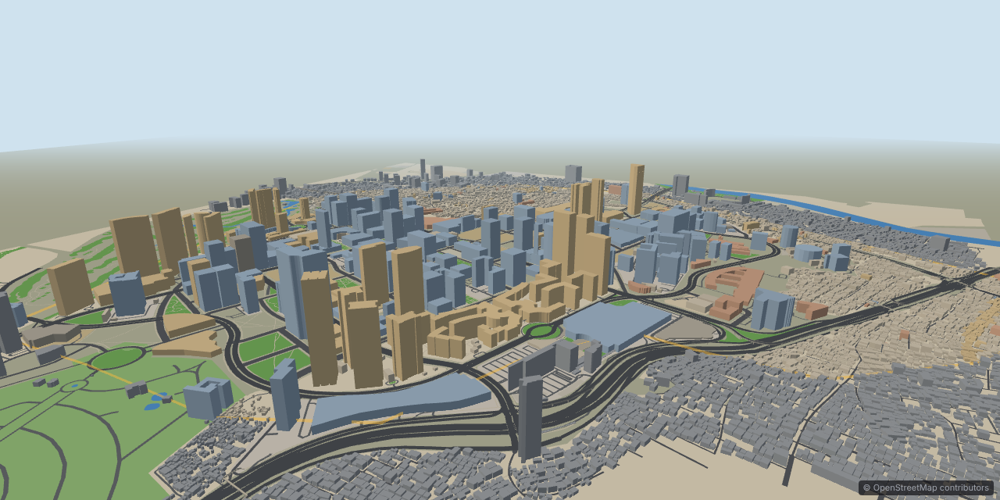
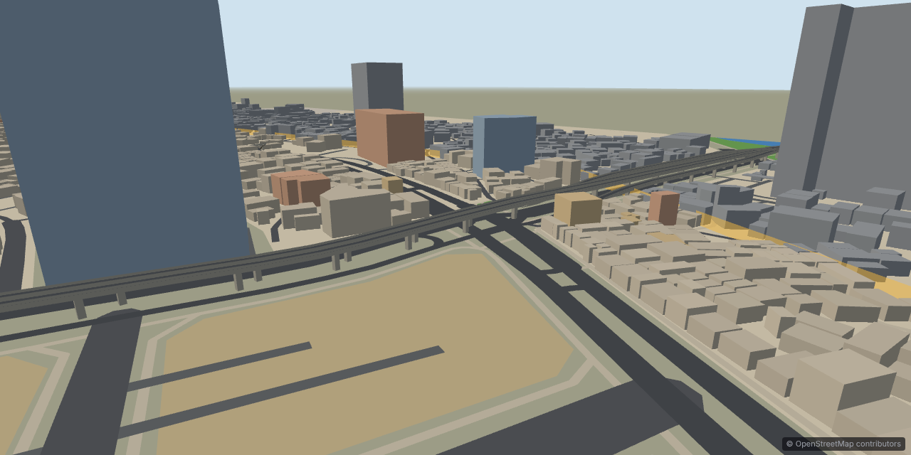

# Drive Thru MNL: No Traffic Edition

[](https://github.com/ajs0905/drive-thru-mnl/actions/workflows/ci.yml)
[](LICENSE)
[](https://www.openstreetmap.org/copyright)

A low-poly, browser-based driving game set in Metro Manila, built from real OpenStreetMap data.

**The idea:** a pipeline that turns real map data into a drivable 3D city that streams into the browser.



> Work in progress. The first playable area is **Bonifacio Global City (BGC), Taguig**. More of Metro Manila (EDSA, C-5, Makati, Ortigas) comes later.

## Highlights

- **Real city from raw map data.** 25,900 OpenStreetMap features become 12,500 buildings, 3,800 roads and 366 land-use areas, clipped to a hand-drawn playable area.
- **Messy data, handled.** Only 3% of buildings have a height in OSM, so heights are estimated by rules. Indoor walkways, basements and skywalks mapped through malls are cleaned up. Roads are narrowed to fit between the houses along them.
- **Flyovers worked out from tags.** OSM only says "bridge, layer 1". The pipeline decides which bridges are really raised (only those crossing a road), builds ramps on the approach roads that stop at junctions, and adds decks, barriers and pillars.
- **Fast to render.** The whole city draws in 8 draw calls (230k triangles), built in about 200 ms.
- **Tested and checked.** 220+ unit tests, an automated map QA scan whose counts gate CI, import rules between modules enforced by a test, and generated data checked against the code on every push.



## Roadmap

- [x] OSM data pipeline, projection and 2D map
- [x] 3D city: playable area, extruded buildings with estimated heights, road surfaces, land use
- [x] Flyovers and footbridges with ramps and pillars, road widths fitted to the street, map cleanup
- [x] Map QA, architecture docs, CI
- [ ] Better roads: lane markings, clean intersections, curbs; procedural sky
- [ ] Better buildings: windows, roof details
- [ ] Walls and fences from OSM
- [ ] Drivable car with NFS-style limits (solid buildings, barriers, surface grip, respawn)
- [ ] Tile streaming and quality tiers for phones
- [ ] Minimap, landmarks, polish
- [ ] Live on Vercel

## Getting started

Requires Node 22 or newer.

```bash
npm install
npm run dev
```

The BGC map data is already in the repo, so that's all you need. Drag to pan, right-drag to rotate, scroll to zoom.

| Command | What it does |
| --- | --- |
| `npm run dev` | Start the game locally |
| `npm test` | Unit tests |
| `npm run pipeline` | Rebuild `public/data/bgc.json` from the raw export |
| `npm run qa` | Scan the map for known problems, with camera links |
| `npm run check` | Everything CI runs: typecheck, lint, tests, data in sync, QA gate |

## Docs

- [Architecture](docs/ARCHITECTURE.md): how it's built, module boundaries, data contract, rendering, quality tiers, testing, roadmap
- [Map data](docs/DATA.md): sources, refreshing the data, each pipeline step, building heights, map QA
- [Performance](docs/PERFORMANCE.md): budgets per quality tier, measured numbers, how to profile on a phone
- [Decisions](docs/decisions/): one page per big decision and its trade-offs

## Stack

- Three.js via React Three Fiber, TypeScript, Vite
- Node + TypeScript data pipeline (`pipeline/`)
- Vitest, oxlint, GitHub Actions

## Credits and license

- Code: [MIT](LICENSE), Adrian Joseph B. Salva
- Map data © [OpenStreetMap contributors](https://www.openstreetmap.org/copyright), available under the Open Database License (ODbL)
- Polygon triangulation: [earcut](https://github.com/mapbox/earcut)
