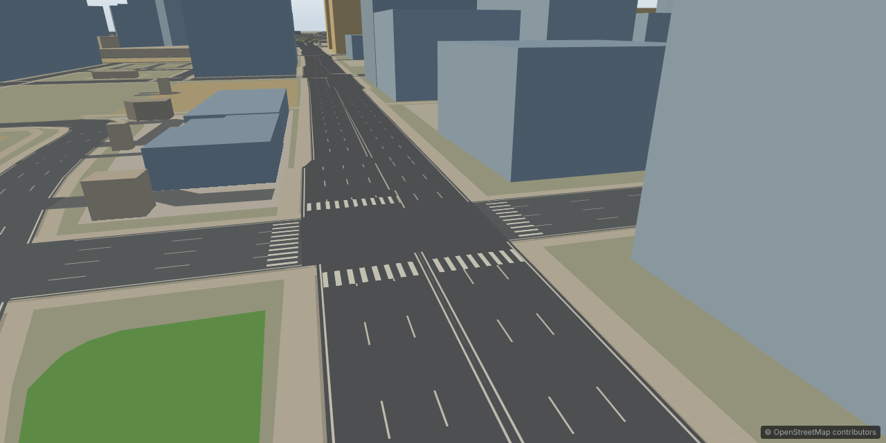
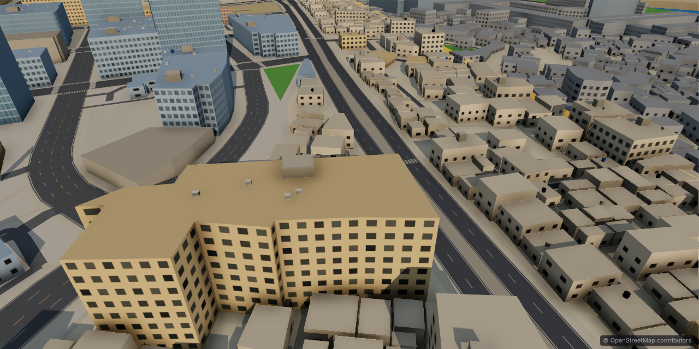

# Drive Thru MNL: No Traffic Edition

[](https://github.com/ajs0905/drive-thru-mnl/actions/workflows/ci.yml)
[](LICENSE)
[](https://www.openstreetmap.org/copyright)

A low-poly, browser-based driving game set in Metro Manila, built from real OpenStreetMap data.

**The idea:** a pipeline that turns real map data into a drivable 3D city that streams into the browser.


> Work in progress. The first playable area is **Bonifacio Global City (BGC), Taguig**. More of Metro Manila (EDSA, C-5, Makati, Ortigas) comes later.

## Highlights

- **Real city from raw map data.** 25,900 OpenStreetMap features become 12,500 buildings, 4,100 road segments and 366 land-use areas, clipped to a hand-drawn playable area.
- **Messy data, handled.** Only 3% of buildings have a height in OSM, so heights are estimated by rules. Indoor walkways, basements and skywalks mapped through malls are cleaned up. Roads are narrowed to fit between the houses along them.
- **Flyovers worked out from tags.** OSM only says "bridge, layer 1". The pipeline decides which bridges are really raised (only those crossing a road), builds ramps on the approach roads that stop at junctions, and adds decks, barriers and pillars.
- **Clean intersections, painted roads.** Roads are split into a graph and every junction gets its own polygon, worked out from where the road edges meet; junctions of divided roads merge into one, and leftover gaps are found by rasterizing the road surface and paved. Lane lines, center lines, zebra crossings and curbs are drawn by a shader from per-vertex data: no textures, no extra draw calls.
- **Windows without textures.** Every building gets windows from its type and height (glass towers, offices, apartments, houses, parking decks), drawn by a shader; roofs get stair housings, AC units and water tanks.
- **Walls and trees that respect the streets.** Walls, fences and hedges from OSM are cut open wherever a road or path passes, street trees mapped a meter into the road are moved to the curb, and gates and parking booms turn to span the road they sit on. 900+ trees (palms where the species says so) and 300 street fixtures, drawn as GPU instances; trees are low-poly models built in code (three broadleaf shapes and palms with drooping fronds).
- **No edge of the world.** Past the mapped area the city continues as filler blocks out to the haze, with the real skylines of Makati and Ortigas where they actually are, and the Rizal hills on the eastern horizon.
- **Lighting that scales with the device.** Sun shadows that follow the camera on Medium and High; tone mapping and baked contact shading everywhere. A Low / Medium / High switch plus resolution that adapts to the frame rate keeps phones smooth, and nothing is drawn while nothing moves.
- **Drive it.** Press Drive (or Enter) and a car appears on the nearest road. Arcade handling on real physics (Rapier): speed-sensitive steering, handbrake drifts with a drift assist that keeps them controllable, a body that squats, dips and leans, a kick at every gear change, glowing brake lights, and a chase camera that swings around corners, reacts to acceleration and braking, and shakes on a crash. Buildings, walls and posts are solid, and the flyovers are drivable. The physics engine only downloads when you start driving.
- **Fast to render.** The city is merged into a few big meshes per layer and grid cell (about 50 to 80 draw calls), cells off screen are skipped, and an idle view costs nothing. Built in about 300 ms.
- **Tested and checked.** 470+ unit tests (the car's handling runs in the real physics engine in tests), an automated map QA scan whose counts gate CI, import rules between modules enforced by a test, and generated data checked against the code on every push.






## Roadmap

- [x] OSM data pipeline, projection and 2D map
- [x] 3D city: playable area, extruded buildings with estimated heights, road surfaces, land use
- [x] Flyovers and footbridges with ramps and pillars, road widths fitted to the street, map cleanup
- [x] Map QA, architecture docs, CI
- [x] Better roads: lane markings, clean intersections, zebra crossings, sidewalks and curbs; physically based sky with clouds
- [x] Better buildings: windows, roof details
- [x] Lighting and surroundings: shadows, tone mapping, Low / Medium / High switch with adaptive resolution; filler city, real skylines and hills past the map
- [x] Performance: reversed depth, grid-cell culling, render on demand
- [x] Walls, fences, trees, gates and parking booms from OSM; low-poly tree models built in code
- [x] Drivable car, first step: Rapier physics with arcade handling, chase camera, brake lights
- [x] Solid buildings, walls, posts and the playable edge
- [x] Drivable flyovers and ramps; a steadier camera in crashes
- [ ] Touch controls and respawn
- [ ] Time trials and races through real streets
- [ ] Tile streaming and quality tiers for phones
- [ ] Minimap, landmarks, polish
- [ ] Live on Vercel

## Getting started

Requires Node 22 or newer.

```bash
npm install
npm run dev
```

The BGC map data is already in the repo, so that's all you need. Drag to pan, right-drag to rotate, scroll to zoom.

Press **Drive here** (or Enter) to drive from where the camera looks: W A S D or the arrow keys, Space for the handbrake (tap it while steering to start a drift, then hold throttle and steer to keep it going), R to reset the car, Esc to go back to the map. Buildings, walls and posts are solid; flyovers and their ramps are drivable, and you can drive under them where there's room.

| Command | What it does |
| --- | --- |
| `npm run dev` | Start the game locally (add `?q=low`, `?q=medium` or `?q=high` to the URL to force a quality tier) |
| `npm test` | Unit tests |
| `npm run pipeline` | Rebuild `public/data/bgc.json` from the raw export |
| `npm run qa` | Scan the map for known problems, with camera links |
| `npm run check` | Everything CI runs: typecheck, lint, tests, data in sync, QA gate |

## Docs

- [Architecture](docs/ARCHITECTURE.md): how it's built, module boundaries, data contract, rendering, quality tiers, testing, roadmap
- [Map data](docs/DATA.md): sources, refreshing the data, each pipeline step, building heights, map QA
- [Performance](docs/PERFORMANCE.md): budgets per quality tier, measured numbers, how to profile on a phone
- [Decisions](docs/decisions/): one page per big decision and its trade-offs

## Stack

- Three.js via React Three Fiber, TypeScript, Vite
- Rapier physics via `@react-three/rapier`, loaded on demand
- Node + TypeScript data pipeline (`pipeline/`)
- Vitest, oxlint, GitHub Actions

## Credits and license

- Code: [MIT](LICENSE), Adrian Joseph B. Salva
- Map data © [OpenStreetMap contributors](https://www.openstreetmap.org/copyright), available under the Open Database License (ODbL)
- Polygon triangulation: [earcut](https://github.com/mapbox/earcut)
- Car: Sedan from the [Free Low Poly Vehicles Pack](https://rgsdev.itch.io/free-low-poly-vehicles-pack) by Rgsdev (CC0), converted with `tools/car-to-glb.ts`
