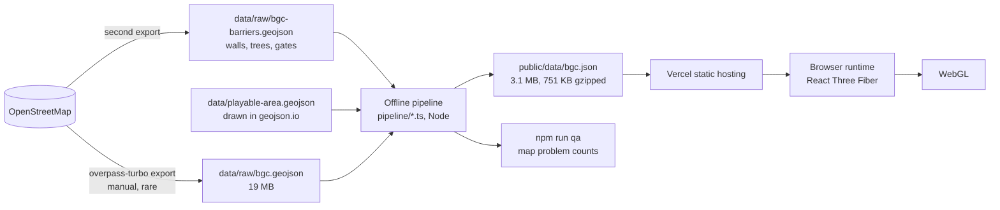
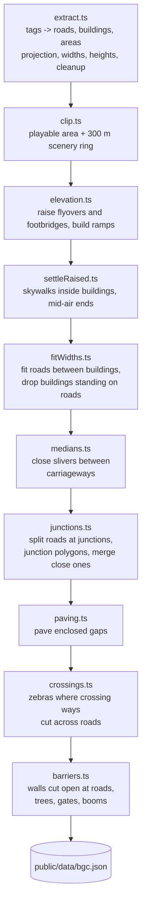
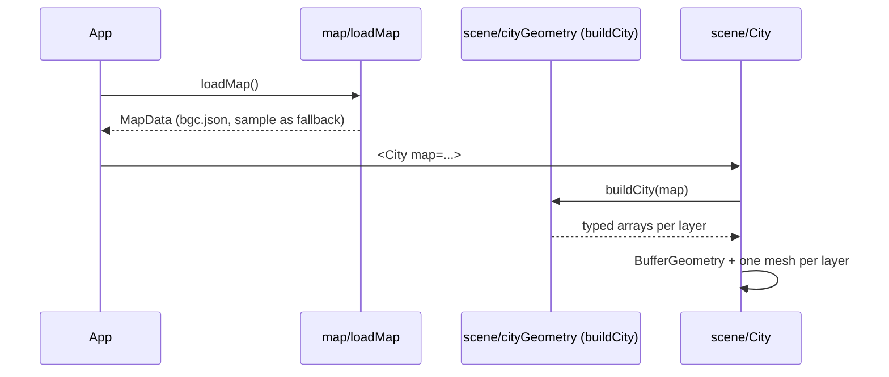
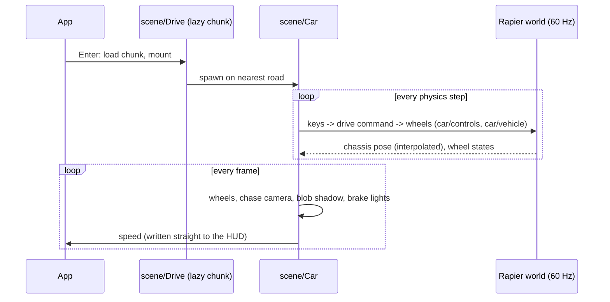
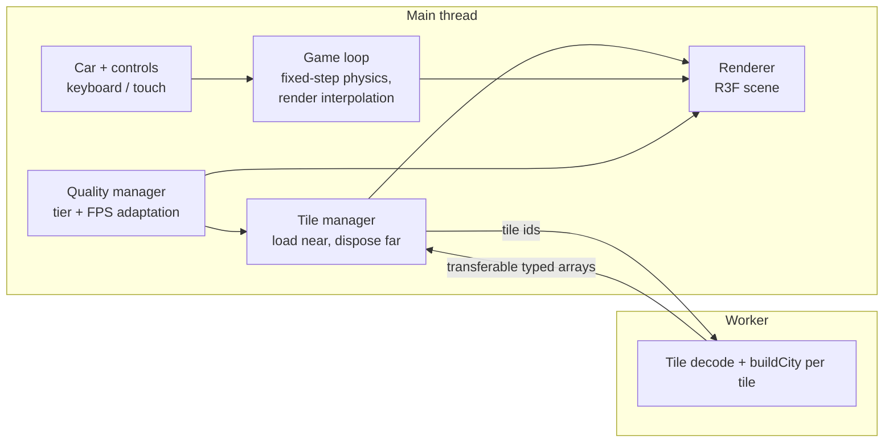

# Architecture

How Drive Thru MNL is put together, why, and where it's going.

- [1. Goals and constraints](#1-goals-and-constraints)
- [2. System overview](#2-system-overview)
- [3. Repository layout and module boundaries](#3-repository-layout-and-module-boundaries)
- [4. Offline pipeline](#4-offline-pipeline)
- [5. Data contract](#5-data-contract)
- [6. Runtime](#6-runtime)
- [7. Rendering strategy](#7-rendering-strategy)
- [8. Quality tiers](#8-quality-tiers)
- [9. Testing strategy](#9-testing-strategy)
- [10. CI and deployment](#10-ci-and-deployment)
- [11. Decisions](#11-decisions)
- [12. Roadmap through the architecture](#12-roadmap-through-the-architecture)
- [13. Glossary](#13-glossary)

Related: [DATA.md](DATA.md) (how the map data is made), [PERFORMANCE.md](PERFORMANCE.md) (budgets and measurements), [decisions/](decisions/) (one page per big decision).

## 1. Goals and constraints

**Goal:** turn real OpenStreetMap data into a drivable low-poly city that runs in the browser, starting with Bonifacio Global City (BGC) and growing to more of Metro Manila.

**The game:** open-world arcade driving. Free roam through real Manila, with time trials and races started from spots on the map, and arcade handling on real physics ([ADR 0014](decisions/0014-open-world-arcade-driving-game.md), [ADR 0008](decisions/0008-car-physics.md)).

| Constraint | What it means for the design |
| --- | --- |
| Static hosting (Vercel), no backend | All heavy processing happens ahead of time. The browser only downloads files. |
| Real, messy map data | Every pipeline step must handle bad input (missing tags, broken shapes, data that contradicts itself) and count what it skips instead of crashing. |
| Phones, including low-mid range Android phones | Memory and draw calls are budgeted. Quality scales down by tier instead of the game being desktop-only. |
| The map will grow (Makati, Ortigas, EDSA) | Nothing may assume the whole world fits in memory. Tile streaming is planned before expansion. |
| Portfolio project | Code is tested, decisions are written down, numbers are measured, not guessed. |

## 2. System overview



Two halves that share one data contract (`src/map/types.ts`):

- **Offline pipeline** (Node, runs on a developer machine and in CI): GeoJSON in, a compact processed map out. Slow, careful work lives here: projection, cleanup, clipping, elevation, width fitting.
- **Browser runtime**: loads the processed map, turns it into a few merged meshes, renders it, and runs the car (physics loaded on demand when driving starts). Later: streams tiles.

Doing the expensive work offline keeps the browser fast and makes the output **deterministic**: running the pipeline twice gives a byte-identical file, which CI checks.

## 3. Repository layout and module boundaries

```
src/
  geo/        projection: lat/long <-> local meters             pure TS
  geometry/   polygons, clipping, spatial grid, extrusion,      pure TS, no three.js, no React
              road ribbons, junction polygons, mesh builder
              (typed arrays)
  map/        data contract (types.ts), loader, hashing,         pure TS (loader uses fetch)
              shared road rules (lanes, sidewalks)
  car/        car spec and tuning, arcade controls, chase         pure TS, no three.js, no React
              camera math, spawn point, Rapier vehicle setup      (Rapier objects passed in)
  scene/      three.js / React Three Fiber components            the only place that knows about rendering
  App.tsx     HUD, camera, drive mode, wiring
pipeline/     offline steps + CLI (build.ts) + map QA (qa.ts)    Node only
tools/        one-off asset tools (car FBX -> GLB)               Node only, run by hand
data/         raw OSM export, Overpass query, playable area
public/data/  processed map the game loads
public/models/ car models (GLB)
docs/         this folder
```

**Dependency rules** (enforced by `tests/architecture.test.ts`):

| Module | May import | Must not import |
| --- | --- | --- |
| `src/geo`, `src/map` (except the loader) | nothing app-specific | three.js, React, `src/scene`, `pipeline` |
| `src/geometry` | `src/map/types`, other geometry files | three.js, React, `src/scene`, `pipeline` |
| `src/car` | `src/map/types`, Rapier (types; the engine is passed in) | three.js, React, `src/scene`, `pipeline` |
| `src/scene` | `src/geometry`, `src/map`, three.js, React | `pipeline` |
| `pipeline` | `src/geo`, `src/geometry`, `src/map` | `src/scene`, three.js, React |
| anything in `src` | | `pipeline`, Node built-ins (outside tests) |

Why it matters:

- `src/geometry` is shared by the pipeline (clipping, distances, spatial grid) and the runtime (meshes). Keeping it free of three.js and React means it runs in Node, in tests, and later in a **Web Worker** without changes.
- The mesh builder outputs plain typed arrays, not three.js objects, for the same reason. Only `src/scene` wraps them in `BufferGeometry`.
- The runtime never pulls in pipeline code, so the browser bundle stays small and Node-only code can't leak into it.
- `src/car` holds the handling and camera math without rendering, so the car's feel is unit tested, and its physics tests run the real engine in Node.

## 4. Offline pipeline

`npm run pipeline` runs `pipeline/build.ts`, which chains small steps. Each step is a pure function from data to data, with its own tests and its own stats line in the output.



| Step | Responsibility | Key algorithms |
| --- | --- | --- |
| `extract.ts` | Classify OSM features, project to meters, drop indoor/underground junk, parse heights and widths | Equirectangular projection, shoelace area, rule tables (`heights.ts`, `roadWidth.ts`) |
| `clip.ts` | Keep the playable area and a scenery ring, trim the rest | Point-in-polygon, segment-to-polygon distance, Sutherland-Hodgman, Liang-Barsky |
| `elevation.ts` | Decide which bridges are raised and how ramps reach them | Node snapping by shared coordinates, union-find, spatial grid crossing test, graph walks that stop at junctions, smoothstep |
| `settleRaised.ts` | Clean up raised ways (skywalks through malls, scraps, mid-air ends) | Point-in-polygon, wall distance via spatial grid |
| `fitWidths.ts` | Narrow roads to the space between buildings; remove buildings on road surfaces | Exact segment-to-segment distance via spatial grid |
| `medians.ts` | Widen carriageways of divided roads that almost touch, so no thin line shows between them | Parallel-segment search via spatial grid, median of sampled gaps |
| `junctions.ts` | Split roads where they cross, build one polygon per junction, record how far each road end is cut back, merge junctions of divided roads crossing, fill in lane counts | Node degree in the road graph, line-line intersection of road edges, angular sort, iterative re-aiming on curves, self-intersection test (`src/geometry/junction.ts`), union-find, convex hull |
| `paving.ts` | Find patches of ground enclosed by road and pave the small ones | Triangle rasterization on a 0.5 m grid, flood fill, connected components, convex hulls per chunk |
| `crossings.ts` | Turn mapped crossing footways into straight zebras across the roads they actually cut, outside junctions, without overlaps | Segment intersection via spatial grid, angle filter, arc-length placement, separating axis test |
| `barriers.ts` | Walls, fences, trees and street fixtures from the second export: clip, cut barriers open where roads pass, move curbside trees off the road, turn gates and booms across their road | Arc-length sampling against road surfaces via spatial grid, interval merging, polyline slicing, point-to-segment projection, seeded variation |
| `qa.ts` | Count known kinds of map problems with camera links | Same geometry helpers; runs on the output |

Rules every step follows:

- **Never crash on bad data.** Unusable features are skipped and counted (`stats.skipped`), and each step prints what it changed.
- **Never mutate its input.** Easier to test and to reorder.
- **Deterministic.** No randomness; per-building variation comes from a hash of the OSM id (`src/map/hash.ts`).

Details of each step and the data sources: [DATA.md](DATA.md).

## 5. Data contract

`src/map/types.ts` defines `MapData`, the only thing the pipeline and the runtime share at run time.

| Field | Contents |
| --- | --- |
| `version` | Format version, currently **6**. The loader refuses any other version with a clear "run `npm run pipeline`" message. |
| `origin` | The lat/long of local (0, 0). |
| `bounds`, `playable` | Extent in meters; outline of the drivable area. |
| `roads[]` | `points` (meters), `w` (width), `cls` (major/minor/service/path), optional `z[]` (height per point), `lanes`, `oneway`, `sidewalk` (both/left/right/none), `trim` (meters a junction polygon covers at each end), `bridge`, `layer`, `tunnel`, `scenery`. |
| `junctions[]` | One polygon per road junction: `ring`, `z` (height, for junctions on flyovers), `cls` (highest road class meeting there), `patch` (fills a small gap; drawn under the roads). |
| `crossings[]` | Zebra crossings: center on the road's centerline `c`, road direction `dir`, `half` road width, band width `w`, height `z`, `cls` of the road crossed. |
| `buildings[]` | `rings` (outer + holes), `h` (top), optional `minH` (bottom, for canopies), `hSrc` (tag/levels/estimate), `type`, `scenery`. |
| `areas[]` | Parks, water, plazas, land use as polygons. |
| `barriers[]` | Walls, fences, hedges, rails: `kind`, `h`, `points`, `scenery`. Already cut open where roads pass. Optional (second export). |
| `trees[]` | `p`, `shape` (broad/palm), `s` (size factor). Optional. |
| `fixtures[]` | Gates, booms, bollards, blocks: `kind`, `p`, `rot` (direction they span), `span` (opening width). Optional. |
| `stats` | Counts from the pipeline, shown in the HUD. |

**Coordinates.** Map space is meters with x = east, y = north, rounded to centimeters. three.js space is x = east, y = up, z = south, so a map point `(x, y)` at height `h` becomes `(x, h, -y)`. The conversion lives in one place (`to3` in `src/geometry/meshBuilder.ts`).

**Versioning policy.** Any change that an older loader would misread bumps `version`. Additions that old code can safely ignore don't.

**Planned: tile format.** For streaming, the single JSON file becomes a grid of tiles (for example 250 m squares), each a compact binary file of typed arrays (quantized coordinates, indices) plus a small JSON manifest. The `MapData` types stay the in-memory model; only the transport changes.

## 6. Runtime

**Today:**



`buildCity` is pure and synchronous (about 200 ms on a desktop CPU). It's written against plain arrays so it can move into a worker unchanged.

**Drive mode** (in now): pressing Drive (or Enter) loads `scene/Drive.tsx` and the physics engine as a separate chunk, puts the car on the road nearest to where the camera looks (`car/spawn.ts`), and switches the canvas from on-demand to continuous rendering. Esc goes back to the map, with the camera lifted to an overview of where the car stopped.



The map controls stay mounted while driving, without input and with their limits opened up so they leave the chase camera alone; their target follows the car, and the sun's shadow area and the prop distance limits follow that target.

**Planned runtime** (tiles, tiers, events):



- **Tile manager:** keeps tiles within a radius of the car loaded (radius set by the quality tier), builds meshes in a worker, disposes GPU buffers for tiles that fall out of range, and reuses objects instead of reallocating them.
- **Game loop:** physics at a fixed step (for example 60 Hz), rendering interpolated, so handling doesn't depend on frame rate.
- **Physics:** Rapier ray-cast vehicle with arcade assists, fixed 60 Hz step, rendering interpolated ([ADR 0008](decisions/0008-car-physics.md)). Colliders from the map come in steps: flat ground now; buildings near the car, walls and the playable edge next; then flyover decks.

## 7. Rendering strategy

- **Merged meshes per layer, split into 1.2 km grid cells**, not one per building or road: playable buildings, scenery buildings, roads, ground and bridge structures each become one mesh per cell (`src/geometry/chunks.ts`), with one shared material per layer. Rooftop details, street fixtures and trees are instanced per cell (`src/scene/Props.tsx`, one mesh per shape or tree model), the filler city per direction sector; walls and fences join the flyover concrete layer. Cells off screen or outside the shadow map's area are skipped, and props and trees farther than a tier-dependent distance are hidden. About **50 to 80 draw calls**. Colors are per vertex. See [ADR 0003](decisions/0003-merged-meshes-per-layer.md).
- **Trade-off:** everything stays on the GPU, and cells are coarse. Tiles take this further: smaller cells, loaded and unloaded as the camera moves.
- **Render on demand:** frames are drawn only when something changes (camera input, the camera settling, shadows catching up), so an idle view costs nothing. `?render=always` draws continuously, for benchmarks; driving will too.
- **Layering without flicker:** flat layers sit at small fixed heights (ground 0.02 to 0.09 m, sidewalks 0.10 m, footpaths 0.12 m, gap patches 0.14 m, roads 0.16 to 0.24 m by class, zebra crossings 0.28 m) on top of a base plane at -0.15 m, plus polygon offset. Junction polygons replace overlapping road ends, so roads of different classes no longer fight at intersections.
- **Style:** flat low-poly, vertex colors, no photo textures.
- **Road markings in a shader:** the road layer carries one extra vec4 per vertex (distance along, offset across, half width, packed style). A Lambert material patched with `onBeforeCompile` (`src/scene/roadMaterial.ts`) draws edge lines, lane dividers, center lines, zebra crossings and curbs from that, antialiased with `fwidth` and faded out when thinner than a pixel. No textures, no extra draw calls. See [ADR 0009](decisions/0009-road-markings-in-a-shader.md).
- **Windows in a shader:** building walls carry meters along the wall, meters up, wall length and a packed window style per vertex; a patched Lambert material (`src/scene/buildingMaterial.ts`) draws glass curtain walls, office grids, apartment rows, house windows or parking decks, blending to the average facade color in the distance. Rooftop housings, AC units and water tanks are placed by `src/geometry/roofProps.ts` and drawn as instances. See [ADR 0010](decisions/0010-building-windows-and-roof-details.md).
- **Trees built in code:** three broadleaf variants (round, wide umbrella, tall) and a palm with drooping fronds, 50 to 82 triangles each, made from jittered icosahedron clusters and tapered prisms (`src/geometry/treeShapes.ts`). Bark and a reference leaf green are vertex colors; each tree's instance color is the ratio of its palette green to that reference, so no custom shader is needed. Low keeps the old trunk-plus-crown trees (38 triangles). See [ADR 0013](decisions/0013-tree-models-built-in-code.md).
- **The car:** the Sedan from a CC0 low-poly pack, converted once to a 16 KB (gzipped) GLB by `tools/car-to-glb.ts`: scaled to a real sedan, materials baked into vertex colors so the body draws in one call and each wheel in one, lamps split out so they can glow. It doesn't cast into the sun's shadow map (re-rendered only every few frames, so a fast car's shadow would trail); a soft blob shadow under it follows every frame and works on Low too. Lamps glow by emissive color, not real lights, and skip tone mapping so the brake lights visibly brighten. About 1,500 triangles and 8 draw calls.
- **Lighting by quality tier:** ACES tone mapping everywhere; sun shadows around the camera's focus on Medium and High, re-rendered only when that area moves and at most every few frames while it does (`src/scene/Sun.tsx`); hardware anti-aliasing on Medium and High. No post-processing pass. See section 8 and [ADR 0011](decisions/0011-lighting-by-quality-tier.md).
- **Depth:** a reversed depth buffer where the GPU supports it (`EXT_clip_control`), so far-away layers don't flicker and the GPU can still skip hidden pixels early; a logarithmic depth buffer otherwise.
- **Surroundings:** past the scenery ring there's no data, so the map would end in flat ground. Seeded filler blocks (`src/geometry/outskirts.ts`) continue the city out to where the haze covers everything, with tower clusters where the real skylines are (Makati CBD, Ortigas, Rockwell, Shaw, placed from their real lat/long). Two low-poly ridges stand in for the Rizal hills on the eastern horizon; they follow the camera like the sky, and their colors are pre-mixed with the haze (`src/scene/Surroundings.tsx`).
- **Sky:** three.js's physically based `Sky` (Preetham scattering model with built-in procedural clouds), following the camera (`src/scene/Sky.tsx`, settings in `skyConfig.ts`). No textures to download. The city renders without tone mapping, so the sky applies its own ACES curve, and just above the horizon it blends into the fog's haze color; the ground plane reaches past the fog, so the city fades into the sky with no visible edge. The directional light comes from the sun's direction. Photo skyboxes (HDRIs) were considered and rejected: they clash with the flat style and cost megabytes on phones.

## 8. Quality tiers

Same game and map everywhere; detail scales with the device.

| | Low (reference: low-mid range phone) | Medium | High (desktop) |
| --- | --- | --- | --- |
| Render resolution | 0.6 to 0.8 of screen, dynamic | 0.8 to 1.0, dynamic | Native, up to 2x pixel ratio |
| Tile radius / draw distance | Small, fog brought in | Medium | Large |
| Scenery ring | Boxes or hidden | Simplified | Full |
| Props, roof details | Few / off | Some | All |
| Window shader | Simple | Full | Full |
| Shadows (in now) | Off | 1024 map around the camera's focus | 2048 map |
| Hardware anti-aliasing (in now) | Off | On | On |
| Rooftop details and street fixtures shown within (in now) | 500 m | 900 m | 1,400 m |
| Trees shown within (in now) | 1,000 m | 1,800 m | 3,000 m |
| Trees (in now) | Trunk and one crown (38 triangles) | Tree models (50 to 82 triangles) | Tree models |
| AI traffic | Few | Some | Full |

**Never scaled down:** the real map shapes, roads and flyovers, the car and its handling, the overall look.

**Choosing a tier:** a first guess from device signals (`navigator.deviceMemory`, `hardwareConcurrency`, GPU renderer string, screen size), then live adjustment from measured frame times (step down after sustained drops, step up with headroom). Players can override it in settings.

**In now** (`src/scene/quality.ts`): the guess from pointer type, memory and cores, a Low / Medium / High switch in the HUD (also `?q=low|medium|high`), remembered between visits, and render resolution that adapts to the frame rate within each tier's range. Switching tiers automatically comes with the tiles and tiers milestone.

Budgets per tier: [PERFORMANCE.md](PERFORMANCE.md).

## 9. Testing strategy

| Layer | How it's tested | Where |
| --- | --- | --- |
| Pure math and geometry | Unit tests with known answers (projection vs haversine, shoelace, clipping, offsets), random tests against brute force (spatial grid), winding checks on every generated triangle | `src/geometry/*.test.ts`, `src/geo/*.test.ts` |
| Pipeline steps | Small hand-built fixtures per edge case (multipolygons, indoor ways, creek bridges, skywalks, alleys) | `pipeline/*.test.ts`, `pipeline/__fixtures__/` |
| Whole map | `npm run qa`: counts of known problem kinds on the real output, with camera links. Road checks rasterize what the renderer paves to find enclosed holes | `pipeline/qa.ts`, `pipeline/qaRoads.ts` |
| Architecture | Import rules from section 3 | `tests/architecture.test.ts` |
| Visual | Camera links (`?cam=x,y,z,tx,ty,tz`) to known spots, screenshots before and after changes | manual |
| Devices | Desktop + a low-mid range Android phone via `chrome://inspect` remote DevTools | [PERFORMANCE.md](PERFORMANCE.md) |

Bugs found by looking at the map become QA checks, so they can't quietly come back (see [ADR 0007](decisions/0007-map-qa-as-regression-gate.md)).

## 10. CI and deployment

GitHub Actions (`.github/workflows/ci.yml`) on every push and pull request:

1. `npm ci`
2. Typecheck (`tsc -b`) and lint (`oxlint`)
3. Unit tests (`vitest`)
4. **Map data in sync:** re-run the pipeline and fail if `public/data/bgc.json` changes (the committed data must match the code)
5. **Map QA gate:** fail if any problem count rises above `data/qa-baseline.json`
6. Production build (`vite build`)

Deployment (planned): Vercel builds from `main` and serves `dist/` as static files with compression.

## 11. Decisions

One page each in [decisions/](decisions/):

| # | Decision | Status |
| --- | --- | --- |
| [0001](decisions/0001-preprocess-osm-offline.md) | Process OSM data offline, ship static files | Accepted |
| [0002](decisions/0002-local-projection-in-meters.md) | Equirectangular projection around a local origin | Accepted |
| [0003](decisions/0003-merged-meshes-per-layer.md) | One merged mesh per layer | Accepted |
| [0004](decisions/0004-ship-map-data-in-repo.md) | Commit raw and processed map data to the repo | Accepted |
| [0005](decisions/0005-estimate-building-heights.md) | Rule-based building height estimates | Accepted |
| [0006](decisions/0006-raise-bridges-only-over-roads.md) | Raise a bridge only if it crosses a road | Accepted |
| [0007](decisions/0007-map-qa-as-regression-gate.md) | Map QA counts as a CI regression gate | Accepted |
| [0008](decisions/0008-car-physics.md) | Car physics: Rapier | Accepted |
| [0009](decisions/0009-road-markings-in-a-shader.md) | Road markings drawn by a shader from per-vertex data | Accepted |
| [0010](decisions/0010-building-windows-and-roof-details.md) | Building windows in a shader, roof details as instances | Accepted |
| [0011](decisions/0011-lighting-by-quality-tier.md) | Lighting by quality tier, measured and trimmed for speed | Accepted |
| [0012](decisions/0012-barriers-and-trees-from-a-second-export.md) | Walls and trees from a second export, fitted to the roads | Accepted |
| [0013](decisions/0013-tree-models-built-in-code.md) | Tree models built in code | Accepted |
| [0014](decisions/0014-open-world-arcade-driving-game.md) | An open-world arcade driving game | Accepted |

## 12. Roadmap through the architecture

| Milestone | What it adds or changes |
| --- | --- |
| Better roads + sky (done) | Junction polygons from the road graph (`pipeline/junctions.ts`, `src/geometry/junction.ts`), per-vertex marking data in the mesh builder, road shader for lanes/zebras/curbs, sidewalk bands from tags, sidewalk/parking clutter filtered in `extract.ts`, zebras placed where crossing ways cut across roads (`pipeline/crossings.ts`), merged junctions for divided roads, median slivers closed, enclosed gaps paved (`pipeline/paving.ts`), physically based sky with procedural clouds in `src/scene` |
| Better buildings (done) | Per-wall coordinates in the mesh builder, window shader by building type and height, instanced roof details (housings, AC units, water tanks) |
| Lighting and surroundings (done) | Tone mapping, wall contact darkening, a low morning sun with shadows around the camera's focus, a manual Low / Medium / High switch with adaptive resolution, reversed depth buffer, grid-cell meshes, render on demand; filler city with real skylines past the map, hills on the horizon |
| Barrier data (done) | Second Overpass export (`data/barriers.overpassql`), `pipeline/barriers.ts` (walls cut open at roads, curbside trees moved, gates and booms turned across their road), data contract v6, walls in the structures layer, instanced trees and fixtures, three new QA checks. See [ADR 0012](decisions/0012-barriers-and-trees-from-a-second-export.md). Then tree models built in code for Medium and High ([ADR 0013](decisions/0013-tree-models-built-in-code.md)) |
| Drivable car | In steps. 8a (done): `src/car` (spec, arcade controls, chase camera, spawn, Rapier vehicle), lazy drive mode with the Sedan on flat ground, brake lights, blob shadow. 8b: colliders from playable buildings, the edge wall and barriers. 8c: flyovers and ramps. 8d: surface grip, curbs, respawn with a fade, touch and gamepad. See ADRs 0008 and 0014 |
| Tiles, streaming, tiers | Tile format (section 5), worker build, tile manager, quality manager (section 8), Ramer-Douglas-Peucker simplification for far tiles, billboards for far trees rendered from the tree models |
| Polish | Minimap (reuses `src/scene/MapLines.tsx`), street names, landmarks, props, day/night |
| Ship | Vercel deploy, measured budgets in PERFORMANCE.md, README media |
| Expansion | New Overpass exports per area, tiles make size mostly irrelevant to memory |

## 13. Glossary

| Term | Meaning |
| --- | --- |
| Playable area | The polygon in `data/playable-area.geojson`; where the car can drive |
| Scenery ring | 300 m around the playable area, drawn as backdrop, not drivable |
| Raised | A road or walkway with height above the ground (`z` > 0) |
| Attachment | Where a raised deck meets a ground-level road |
| Deck | The raised part of a flyover or footbridge |
| Layer | (OSM) vertical order tag; (rendering) one merged mesh |
| Tier | Low / Medium / High quality setting |
