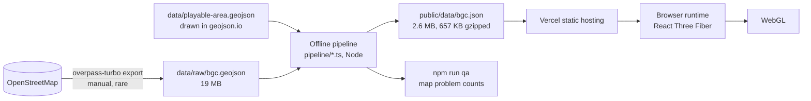
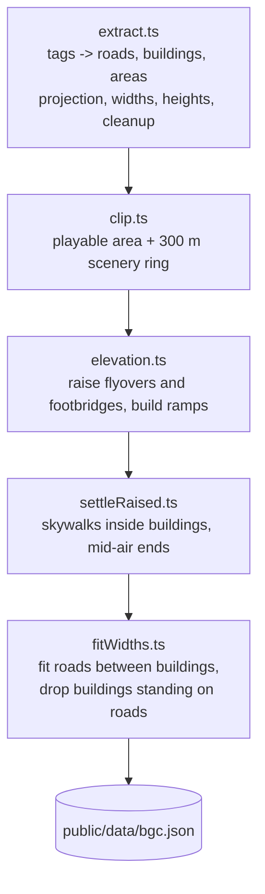
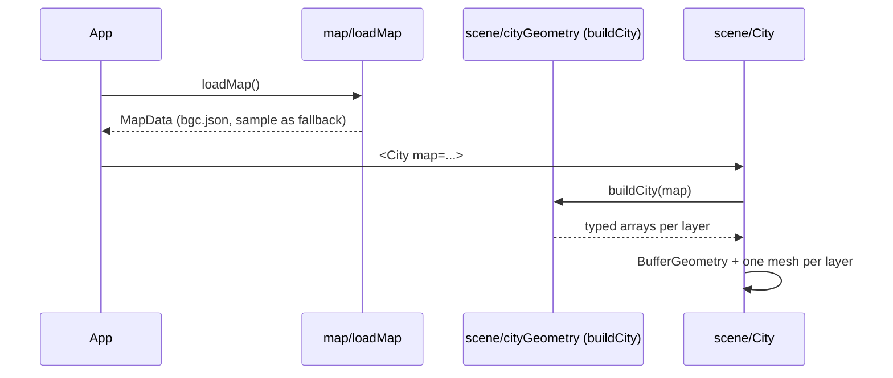
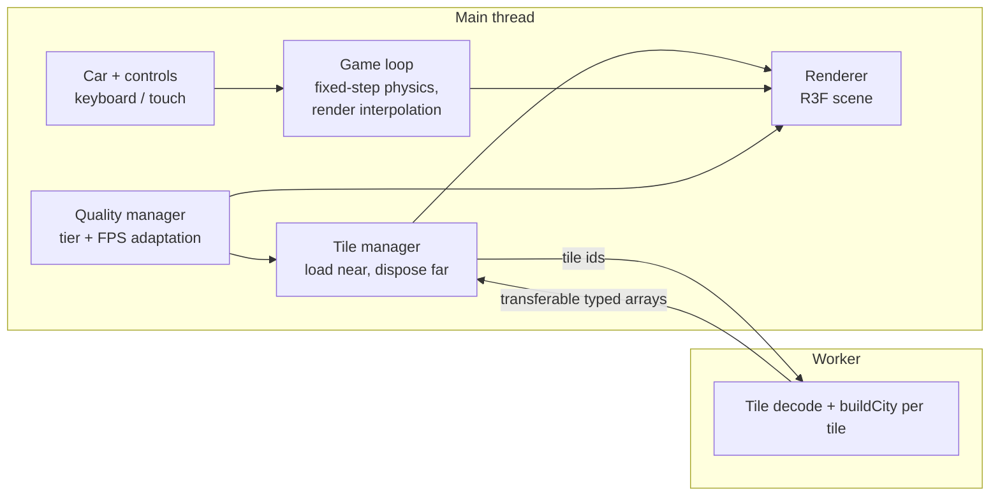

# Architecture

How Drive Thru MNL is put together, why, and where it's going.

- [1. Goals and constraints](#1-goals-and-constraints)
- [2. System overview](#2-system-overview)
- [3. Repository layout and module boundaries](#3-repository-layout-and-module-boundaries)
- [4. Offline pipeline](#4-offline-pipeline)
- [5. Data contract](#5-data-contract)
- [6. Runtime](#6-runtime)
- [7. Rendering strategy](#7-rendering-strategy)
- [8. Quality tiers](#8-quality-tiers)
- [9. Testing strategy](#9-testing-strategy)
- [10. CI and deployment](#10-ci-and-deployment)
- [11. Decisions](#11-decisions)
- [12. Roadmap through the architecture](#12-roadmap-through-the-architecture)
- [13. Glossary](#13-glossary)

Related: [DATA.md](DATA.md) (how the map data is made), [PERFORMANCE.md](PERFORMANCE.md) (budgets and measurements), [decisions/](decisions/) (one page per big decision).

## 1. Goals and constraints

**Goal:** turn real OpenStreetMap data into a drivable low-poly city that runs in the browser, starting with Bonifacio Global City (BGC) and growing to more of Metro Manila.

| Constraint | What it means for the design |
| --- | --- |
| Static hosting (Vercel), no backend | All heavy processing happens ahead of time. The browser only downloads files. |
| Real, messy map data | Every pipeline step must handle bad input (missing tags, broken shapes, data that contradicts itself) and count what it skips instead of crashing. |
| Phones, including low-mid range (reference device: Realme 8) | Memory and draw calls are budgeted. Quality scales down by tier instead of the game being desktop-only. |
| The map will grow (Makati, Ortigas, EDSA) | Nothing may assume the whole world fits in memory. Tile streaming is planned before expansion. |
| Portfolio project | Code is tested, decisions are written down, numbers are measured, not guessed. |

## 2. System overview



Two halves that share one data contract (`src/map/types.ts`):

- **Offline pipeline** (Node, runs on a developer machine and in CI): GeoJSON in, a compact processed map out. Slow, careful work lives here: projection, cleanup, clipping, elevation, width fitting.
- **Browser runtime**: loads the processed map, turns it into a few merged meshes, renders it. Later: streams tiles, runs the car physics and the game loop.

Doing the expensive work offline keeps the browser fast and makes the output **deterministic**: running the pipeline twice gives a byte-identical file, which CI checks.

## 3. Repository layout and module boundaries

```
src/
  geo/        projection: lat/long <-> local meters             pure TS
  geometry/   polygons, clipping, spatial grid, extrusion,      pure TS, no three.js, no React
              road ribbons, mesh builder (typed arrays)
  map/        data contract (types.ts), loader, hashing          pure TS (loader uses fetch)
  scene/      three.js / React Three Fiber components            the only place that knows about rendering
  App.tsx     HUD, camera, wiring
pipeline/     offline steps + CLI (build.ts) + map QA (qa.ts)    Node only
data/         raw OSM export, Overpass query, playable area
public/data/  processed map the game loads
docs/         this folder
```

**Dependency rules** (enforced by `tests/architecture.test.ts`):

| Module | May import | Must not import |
| --- | --- | --- |
| `src/geo`, `src/map` (except the loader) | nothing app-specific | three.js, React, `src/scene`, `pipeline` |
| `src/geometry` | `src/map/types`, other geometry files | three.js, React, `src/scene`, `pipeline` |
| `src/scene` | `src/geometry`, `src/map`, three.js, React | `pipeline` |
| `pipeline` | `src/geo`, `src/geometry`, `src/map` | `src/scene`, three.js, React |
| anything in `src` | | `pipeline`, Node built-ins (outside tests) |

Why it matters:

- `src/geometry` is shared by the pipeline (clipping, distances, spatial grid) and the runtime (meshes). Keeping it free of three.js and React means it runs in Node, in tests, and later in a **Web Worker** without changes.
- The mesh builder outputs plain typed arrays, not three.js objects, for the same reason. Only `src/scene` wraps them in `BufferGeometry`.
- The runtime never pulls in pipeline code, so the browser bundle stays small and Node-only code can't leak into it.

## 4. Offline pipeline

`npm run pipeline` runs `pipeline/build.ts`, which chains small steps. Each step is a pure function from data to data, with its own tests and its own stats line in the output.



| Step | Responsibility | Key algorithms |
| --- | --- | --- |
| `extract.ts` | Classify OSM features, project to meters, drop indoor/underground junk, parse heights and widths | Equirectangular projection, shoelace area, rule tables (`heights.ts`, `roadWidth.ts`) |
| `clip.ts` | Keep the playable area and a scenery ring, trim the rest | Point-in-polygon, segment-to-polygon distance, Sutherland-Hodgman, Liang-Barsky |
| `elevation.ts` | Decide which bridges are raised and how ramps reach them | Node snapping by shared coordinates, union-find, spatial grid crossing test, graph walks that stop at junctions, smoothstep |
| `settleRaised.ts` | Clean up raised ways (skywalks through malls, scraps, mid-air ends) | Point-in-polygon, wall distance via spatial grid |
| `fitWidths.ts` | Narrow roads to the space between buildings; remove buildings on road surfaces | Exact segment-to-segment distance via spatial grid |
| `qa.ts` | Count known kinds of map problems with camera links | Same geometry helpers; runs on the output |

Rules every step follows:

- **Never crash on bad data.** Unusable features are skipped and counted (`stats.skipped`), and each step prints what it changed.
- **Never mutate its input.** Easier to test and to reorder.
- **Deterministic.** No randomness; per-building variation comes from a hash of the OSM id (`src/map/hash.ts`).

Details of each step and the data sources: [DATA.md](DATA.md).

## 5. Data contract

`src/map/types.ts` defines `MapData`, the only thing the pipeline and the runtime share at run time.

| Field | Contents |
| --- | --- |
| `version` | Format version, currently **3**. The loader refuses any other version with a clear "run `npm run pipeline`" message. |
| `origin` | The lat/long of local (0, 0). |
| `bounds`, `playable` | Extent in meters; outline of the drivable area. |
| `roads[]` | `points` (meters), `w` (width), `cls` (major/minor/service/path), optional `z[]` (height per point), `bridge`, `layer`, `tunnel`, `scenery`. |
| `buildings[]` | `rings` (outer + holes), `h` (top), optional `minH` (bottom, for canopies), `hSrc` (tag/levels/estimate), `type`, `scenery`. |
| `areas[]` | Parks, water, plazas, land use as polygons. |
| `stats` | Counts from the pipeline, shown in the HUD. |

**Coordinates.** Map space is meters with x = east, y = north, rounded to centimeters. three.js space is x = east, y = up, z = south, so a map point `(x, y)` at height `h` becomes `(x, h, -y)`. The conversion lives in one place (`to3` in `src/geometry/meshBuilder.ts`).

**Versioning policy.** Any change that an older loader would misread bumps `version`. Additions that old code can safely ignore don't.

**Planned: tile format.** For streaming, the single JSON file becomes a grid of tiles (for example 250 m squares), each a compact binary file of typed arrays (quantized coordinates, indices) plus a small JSON manifest. The `MapData` types stay the in-memory model; only the transport changes.

## 6. Runtime

**Today:**



`buildCity` is pure and synchronous (about 200 ms on a desktop CPU). It's written against plain arrays so it can move into a worker unchanged.

**Planned runtime** (tiles, car, tiers):



- **Tile manager:** keeps tiles within a radius of the car loaded (radius set by the quality tier), builds meshes in a worker, disposes GPU buffers for tiles that fall out of range, and reuses objects instead of reallocating them.
- **Game loop:** physics at a fixed step (for example 60 Hz), rendering interpolated, so handling doesn't depend on frame rate.
- **Physics:** decision pending ([ADR 0008](decisions/0008-car-physics.md)): a Rapier raycast vehicle, or a custom "2.5D" model (height from road `z`, 2D walls from building outlines through the spatial grid).

## 7. Rendering strategy

- **One mesh per layer**, not one per building or road: playable buildings, scenery buildings, roads, ground, bridge structures, playable edge, plus the base plane. About **8 draw calls** for the whole city. Colors are per vertex, so one material per layer is enough. See [ADR 0003](decisions/0003-merged-meshes-per-layer.md).
- **Trade-off:** a merged mesh is all-or-nothing for frustum culling, and everything stays on the GPU. That's fine at BGC's size and is exactly what tiles fix: each tile gets its own small set of merged meshes, so culling and unloading work per tile.
- **Layering without flicker:** flat layers sit at small fixed heights (ground 0.02 to 0.09 m, roads 0.12 to 0.24 m by class) on top of a base plane at -0.15 m, plus polygon offset. A logarithmic depth buffer is on today; on phones it's a candidate to turn off (cost on mobile GPUs).
- **Style:** flat low-poly, vertex colors, no photo textures. Planned shader effects (windows, lane markings) need UVs, which the mesh builder will gain.

## 8. Quality tiers

Same game and map everywhere; detail scales with the device.

| | Low (reference: Realme 8) | Medium | High (desktop) |
| --- | --- | --- | --- |
| Render resolution | 0.6 to 0.8 of screen, dynamic | 0.8 to 1.0, dynamic | Native, up to 2x pixel ratio |
| Tile radius / draw distance | Small, fog brought in | Medium | Large |
| Scenery ring | Boxes or hidden | Simplified | Full |
| Props, roof details | Few / off | Some | All |
| Window shader | Simple | Full | Full |
| Shadows | Off | Off | On (if budget allows) |
| AI traffic | Few | Some | Full |

**Never scaled down:** the real map shapes, roads and flyovers, the car and its handling, the overall look.

**Choosing a tier:** a first guess from device signals (`navigator.deviceMemory`, `hardwareConcurrency`, GPU renderer string, screen size), then live adjustment from measured frame times (step down after sustained drops, step up with headroom). Players can override it in settings.

Budgets per tier: [PERFORMANCE.md](PERFORMANCE.md).

## 9. Testing strategy

| Layer | How it's tested | Where |
| --- | --- | --- |
| Pure math and geometry | Unit tests with known answers (projection vs haversine, shoelace, clipping, offsets), random tests against brute force (spatial grid), winding checks on every generated triangle | `src/geometry/*.test.ts`, `src/geo/*.test.ts` |
| Pipeline steps | Small hand-built fixtures per edge case (multipolygons, indoor ways, creek bridges, skywalks, alleys) | `pipeline/*.test.ts`, `pipeline/__fixtures__/` |
| Whole map | `npm run qa`: counts of known problem kinds on the real output, with camera links | `pipeline/qa.ts` |
| Architecture | Import rules from section 3 | `tests/architecture.test.ts` |
| Visual | Camera links (`?cam=x,y,z,tx,ty,tz`) to known spots, screenshots before and after changes | manual |
| Devices | Desktop + Realme 8 via `chrome://inspect` remote DevTools | [PERFORMANCE.md](PERFORMANCE.md) |

Bugs found by looking at the map become QA checks, so they can't quietly come back (see [ADR 0007](decisions/0007-map-qa-as-regression-gate.md)).

## 10. CI and deployment

GitHub Actions (`.github/workflows/ci.yml`) on every push and pull request:

1. `npm ci`
2. Typecheck (`tsc -b`) and lint (`oxlint`)
3. Unit tests (`vitest`)
4. **Map data in sync:** re-run the pipeline and fail if `public/data/bgc.json` changes (the committed data must match the code)
5. **Map QA gate:** fail if any problem count rises above `data/qa-baseline.json`
6. Production build (`vite build`)

Deployment (planned): Vercel builds from `main` and serves `dist/` as static files with compression.

## 11. Decisions

One page each in [decisions/](decisions/):

| # | Decision | Status |
| --- | --- | --- |
| [0001](decisions/0001-preprocess-osm-offline.md) | Process OSM data offline, ship static files | Accepted |
| [0002](decisions/0002-local-projection-in-meters.md) | Equirectangular projection around a local origin | Accepted |
| [0003](decisions/0003-merged-meshes-per-layer.md) | One merged mesh per layer | Accepted |
| [0004](decisions/0004-ship-map-data-in-repo.md) | Commit raw and processed map data to the repo | Accepted |
| [0005](decisions/0005-estimate-building-heights.md) | Rule-based building height estimates | Accepted |
| [0006](decisions/0006-raise-bridges-only-over-roads.md) | Raise a bridge only if it crosses a road | Accepted |
| [0007](decisions/0007-map-qa-as-regression-gate.md) | Map QA counts as a CI regression gate | Accepted |
| [0008](decisions/0008-car-physics.md) | Car physics: Rapier vs custom 2.5D | Proposed |

## 12. Roadmap through the architecture

| Milestone | What it adds or changes |
| --- | --- |
| Better roads + sky | Junction polygons from the road graph (pipeline or `src/geometry`), UVs in the mesh builder for lane markings, sidewalk/parking clutter filtered in `extract.ts`, procedural sky in `src/scene` |
| Better buildings | Per-wall UVs, window shader, instanced roof details |
| Barrier data | `barrier=*` added to the Overpass query; new pipeline step turning walls and fences into wall geometry |
| Drivable car | Game loop, car module, physics (ADR 0008), colliders from playable buildings, edge wall, barriers; surface grip from area/road type; respawn to nearest road |
| Tiles, streaming, tiers | Tile format (section 5), worker build, tile manager, quality manager (section 8), Ramer-Douglas-Peucker simplification for far tiles |
| Polish | Minimap (reuses `src/scene/MapLines.tsx`), street names, landmarks, props, day/night |
| Ship | Vercel deploy, measured budgets in PERFORMANCE.md, README media |
| Expansion | New Overpass exports per area, tiles make size mostly irrelevant to memory |

## 13. Glossary

| Term | Meaning |
| --- | --- |
| Playable area | The polygon in `data/playable-area.geojson`; where the car can drive |
| Scenery ring | 300 m around the playable area, drawn as backdrop, not drivable |
| Raised | A road or walkway with height above the ground (`z` > 0) |
| Attachment | Where a raised deck meets a ground-level road |
| Deck | The raised part of a flyover or footbridge |
| Layer | (OSM) vertical order tag; (rendering) one merged mesh |
| Tier | Low / Medium / High quality setting |
