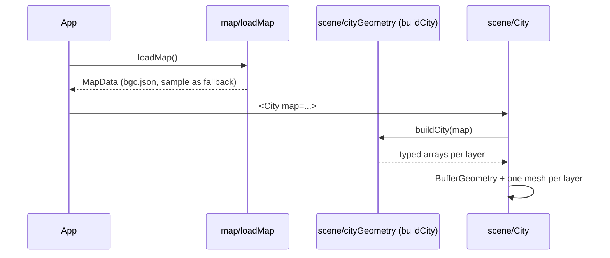
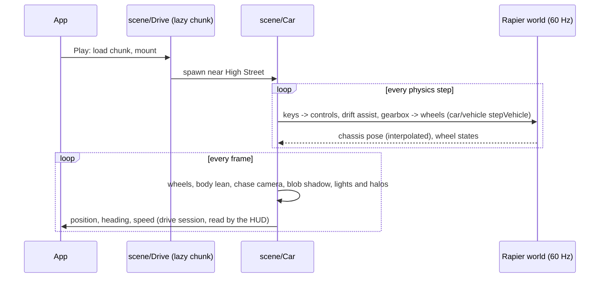
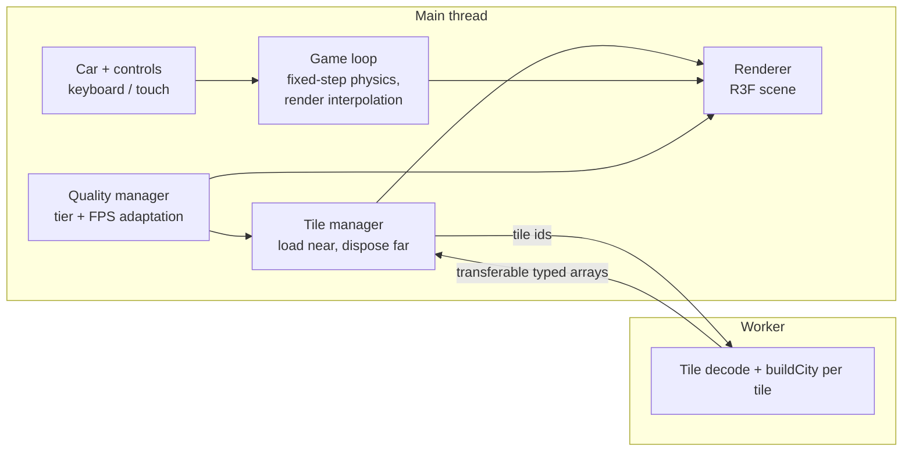

# Architecture

How Drive Thru MNL is put together, why, and where it's going.

- [1. Goals and constraints](#1-goals-and-constraints)
- [2. System overview](#2-system-overview)
- [3. Repository layout and module boundaries](#3-repository-layout-and-module-boundaries)
- [4. Offline pipeline](#4-offline-pipeline)
- [5. Data contract](#5-data-contract)
- [6. Runtime](#6-runtime)
- [7. Rendering strategy](#7-rendering-strategy)
- [8. Quality tiers](#8-quality-tiers)
- [9. Testing strategy](#9-testing-strategy)
- [10. CI and deployment](#10-ci-and-deployment)
- [11. Decisions](#11-decisions)
- [12. Roadmap through the architecture](#12-roadmap-through-the-architecture)
- [13. Glossary](#13-glossary)

Related: [DATA.md](DATA.md) (how the map data is made), [PERFORMANCE.md](PERFORMANCE.md) (budgets and measurements), [decisions/](decisions/) (one page per big decision).

## 1. Goals and constraints

**Goal:** turn real OpenStreetMap data into a drivable low-poly city that runs in the browser, starting with Bonifacio Global City (BGC) and growing to more of Metro Manila.

**The game:** open-world arcade driving. Free roam through real Manila, with modes started from a menu (cargo runs now, police chases next), and arcade handling on real physics ([ADR 0014](decisions/0014-open-world-arcade-driving-game.md), [ADR 0008](decisions/0008-car-physics.md)).

| Constraint | What it means for the design |
| --- | --- |
| Static hosting (Vercel), no backend | All heavy processing happens ahead of time. The browser only downloads files. |
| Real, messy map data | Every pipeline step must handle bad input (missing tags, broken shapes, data that contradicts itself) and count what it skips instead of crashing. |
| Phones, including low-mid range Android phones | Memory and draw calls are budgeted. Quality scales down by tier instead of the game being desktop-only. |
| The map will grow (Makati, Ortigas, EDSA) | Nothing may assume the whole world fits in memory. Tile streaming is planned before expansion. |
| Portfolio project | Code is tested, decisions are written down, numbers are measured, not guessed. |

## 2. System overview


Two halves that share one data contract (`src/map/types.ts`):

- **Offline pipeline** (Node, runs on a developer machine and in CI): GeoJSON in, a compact processed map out. Slow, careful work lives here: projection, cleanup, clipping, elevation, width fitting.
- **Browser runtime**: loads the processed map, turns it into a few merged meshes, renders it, and runs the car (physics loaded on demand when driving starts). Later: streams tiles.

Doing the expensive work offline keeps the browser fast and makes the output **deterministic**: running the pipeline twice gives a byte-identical file, which CI checks.

## 3. Repository layout and module boundaries

```
src/
  geo/        projection: lat/long <-> local meters             pure TS
  geometry/   polygons, clipping, spatial grid, extrusion,      pure TS, no three.js, no React
              road ribbons, junction polygons, mesh builder
              (typed arrays), the car's collision mesh
  map/        data contract (types.ts), loader, hashing,         pure TS (loader uses fetch)
              shared road rules (lanes, sidewalks)
  car/        car spec and tuning, arcade controls, drift         pure TS, no three.js, no React
              assist, gearbox, body lean, chase camera math,      (Rapier objects passed in)
              spawn and curb spots, Rapier vehicle setup and step
  game/       the modes: places and runs (events.json), cargo     pure TS, no three.js, no React
              rules and receipt, run state machine, the game
              session (wallet, GPS), saved progress (validated)
  routing/    road graph, closures, A* and ALT routes, tracking  pure TS, no three.js, no React
  sim/        headless drive (the game's physics without a       pure TS, no three.js, no React
              screen), replays, autopilot                          (Rapier passed in)
  traffic/    light traffic: IDM car-following, junction           pure TS, no three.js, no React
              clusters, spawning around the player
  scene/      three.js / React Three Fiber components            the only place that knows about rendering
  ui/         menu, loading screens, HUD, maps, pause menu       DOM and 2D canvas, no three.js
  App.tsx     screens, drive mode, wiring
pipeline/     offline steps + CLI (build.ts) + map QA (qa.ts)    Node only
tools/        one-off asset tools (car FBX -> GLB)               Node only, run by hand
data/         raw OSM export, Overpass query, playable area
public/data/  processed map the game loads
public/models/ car models (GLB)
docs/         this folder
```

**Dependency rules** (enforced by `tests/architecture.test.ts`):

| Module | May import | Must not import |
| --- | --- | --- |
| `src/geo`, `src/map` (except the loader) | nothing app-specific | three.js, React, `src/scene`, `pipeline` |
| `src/geometry` | `src/map/types`, other geometry files | three.js, React, `src/scene`, `pipeline` |
| `src/car` | `src/map/types`, Rapier (types; the engine is passed in) | three.js, React, `src/scene`, `pipeline` |
| `src/game` | `src/map`, `src/geometry`, `src/car`, `src/routing`, `src/traffic` (the signals and junctions; the sim's types only, so it stays out of the main bundle) | three.js, React, `src/scene`, `pipeline` |
| `src/routing` | `src/map`, `src/geometry` | three.js, React, `src/scene`, `pipeline` |
| `src/sim` | `src/car`, `src/geometry`, `src/map`, `src/routing`, Rapier (passed in) | three.js, React, `src/scene`, `pipeline` |
| `src/traffic` | `src/map`, `src/geometry`, `src/routing` | three.js, React, `src/scene`, `pipeline` |
| `src/scene` | `src/geometry`, `src/map`, three.js, React | `pipeline` |
| `src/ui` | `src/geometry`, `src/map`, `src/car`, React, the drive session in `src/scene` | `pipeline` |
| `pipeline` | `src/geo`, `src/geometry`, `src/map`, `src/routing`, `src/car` | `src/scene`, three.js, React |
| anything in `src` | | `pipeline`, Node built-ins (outside tests) |

Why it matters:

- `src/geometry` is shared by the pipeline (clipping, distances, spatial grid) and the runtime (meshes). Keeping it free of three.js and React means it runs in Node, in tests, and later in a **Web Worker** without changes.
- The mesh builder outputs plain typed arrays, not three.js objects, for the same reason. Only `src/scene` wraps them in `BufferGeometry`.
- The runtime never pulls in pipeline code, so the browser bundle stays small and Node-only code can't leak into it.
- `src/car` holds the handling and camera math without rendering, so the car's feel is unit tested, and its physics tests run the real engine in Node.

## 4. Offline pipeline

`npm run pipeline` runs `pipeline/build.ts`, which chains small steps. Each step is a pure function from data to data, with its own tests and its own stats line in the output.

```mermaid
flowchart TD
  A[extract.ts<br/>tags -> roads, buildings, areas<br/>projection, widths, heights, cleanup] --> B[clip.ts<br/>playable area + 300 m scenery ring]
  B --> C[elevation.ts<br/>raise flyovers and footbridges, build ramps]
  C --> D[settleRaised.ts<br/>skywalks inside buildings, mid-air ends]
  D --> R[smoothRaised.ts<br/>round flyover curves]
  R --> E[fitWidths.ts<br/>fit roads between buildings,<br/>drop buildings standing on roads]
  E --> O[overlaps.ts<br/>drop buildings hidden inside others]
  O --> M[medians.ts<br/>close slivers between<br/>carriageways]
  M --> G[junctions.ts<br/>split roads at junctions,<br/>junction polygons, merge close ones]
  G --> H[crossings.ts<br/>zebras where crossing ways<br/>cut across roads]
  H --> L[roadLayers.ts<br/>drawing order for<br/>overlapping roads]
  L --> P[paving.ts<br/>pave enclosed gaps]
  P --> X[barriers.ts<br/>walls cut open at roads,<br/>trees, gates, booms]
  X --> S[structures.ts<br/>pillars off the roads below,<br/>posts under raised buildings]
  S --> LT[lots.ts<br/>walls around empty lots,<br/>open zones, yard dressing]
  LT --> FL[fixtureLanes.ts<br/>bollards and blocks<br/>out of open lanes]
  FL --> K[parking.ts<br/>parked cars along the curbs]
  K --> LI[lights.ts<br/>traffic lights at the signals,<br/>street lights by rule]
  LI --> SW[sidewalks.ts<br/>sheds, planters, bins,<br/>hydrants, kiosks]
  SW --> SG[signs.ts<br/>stop, one-way and<br/>speed limit signs]
  SW --> F[(public/data/bgc.json)]
```



| Step | Responsibility | Key algorithms |
| --- | --- | --- |
| `extract.ts` | Classify OSM features, project to meters (stretched by the map scale), drop indoor/underground junk, parse heights and widths | Equirectangular projection, shoelace area, rule tables (`heights.ts`, `roadWidth.ts`) |
| `clip.ts` | Keep the playable area and a scenery ring, trim the rest | Point-in-polygon, segment-to-polygon distance, Sutherland-Hodgman, Liang-Barsky |
| `elevation.ts` | Decide which bridges are raised and how ramps reach them, keeping ramps out of other roads' lanes | Node snapping by shared coordinates (per network), union-find, spatial grid crossing test, graph walks that stop at junctions, smoothstep, overlap sampling with a shrinking climb, ordered fallback plans |
| `settleRaised.ts` | Clean up raised ways (skywalks through malls, scraps, mid-air ends) | Point-in-polygon, wall distance via spatial grid |
| `smoothRaised.ts` | Round the curves of flyovers and ramps | Centripetal Catmull-Rom spline, turn-angle subdivision |
| `fitWidths.ts` | Narrow roads to the space between buildings; remove buildings on road surfaces; cut walls back off the roads they still reach into | Exact segment-to-segment distance via spatial grid, Sutherland-Hodgman half-plane clip |
| `overlaps.ts` | Drop buildings hidden inside a bigger one, and construction outlines around finished buildings | Grid sampling of footprint overlap (holes excluded), bounding-box grid for candidate pairs |
| `medians.ts` | Widen carriageways of divided roads that almost touch, so no thin line shows between them | Parallel-segment search via spatial grid, median of sampled gaps |
| `junctions.ts` | Split roads where they cross, build one polygon per junction, record how far each road end is cut back, merge junctions of divided roads crossing, fill in lane counts | Node degree in the road graph, line-line intersection of road edges, angular sort, iterative re-aiming on curves, self-intersection test (`src/geometry/junction.ts`), union-find, convex hull |
| `paving.ts` | Find patches of ground enclosed by road and pave the small ones | Triangle rasterization on a 0.5 m grid, flood fill, connected components, convex hulls per chunk |
| `crossings.ts` | Turn mapped crossing footways into straight zebras across the roads they actually cut, outside junctions, without overlaps | Segment intersection via spatial grid, angle filter, arc-length placement, separating axis test |
| `roadLayers.ts` | Give overlapping same-class roads a drawing order so they don't flicker | Overlap graph via spatial grid sampling, greedy graph coloring |
| `barriers.ts` | Walls, fences, trees and street fixtures from the second export: clip, cut barriers open where roads pass, move curbside trees off the road and away from flyovers, turn gates and booms across their road | Arc-length sampling against road surfaces via spatial grid, interval merging, polyline slicing, point-to-segment projection, seeded variation |
| `structures.ts` | Place deck pillars clear of the lanes below (sliding, medians, outrigger piers) and posts under raised buildings; curbs around deck pillars where they stay out of the lanes | Arc-length search along the deck, line-segment intersection for medians, spatial grid, inward normals from ring orientation |
| `lots.ts` | Close most empty land (construction sites, vacant lots, gardens) with hoarding, lot walls or hedges at the back of the sidewalk; open three zones (a park, a sports field, a surface parking yard with stalls and cars); fill construction yards and dress the open park | Rasterization, breadth-first distance transform, contour tracing through cell-side midpoints, Ramer-Douglas-Peucker simplification, arc-length sampling against roads and paths with interval merging, separating axis test for placements, convex hull, seeded variation |
| `fixtureLanes.ts` | Move bollards and concrete blocks OSM left in the lanes of a road they don't close to just past its curb (or drop them if there's no room), after the lots add theirs | Segment grid, point-to-segment projection, the same closed-road test as the routing (`src/routing/closures.ts`) |
| `parking.ts` | Park cars along the curbs of minor streets wide enough to still drive past, clear of junctions, crossings, driveways, trees and walls | Arc-length slots, seeded weighted picks, rectangle footprints, separating axis test, segment-to-polygon distance via spatial grid |
| `lights.ts` | Traffic lights for every road arriving at an intersection with a mapped signal, on the far side (the far right-hand corner past the far crosswalk, arm over the lanes ahead, heads facing back at the traffic; a post on the far curb across a T; one per corner), street lights along avenues and wider streets (nudged along the curb for room); poles keep clear of drawn roofs and awnings, parked cars, crossings, junction paving and anything overhead | Point-to-polygon distance to find signalized junctions, a graph walk grouping junctions joined by median links into intersections and following each approach straight through, arc-length placement and projection, a slide-on and nudge search for room, separating axis tests, the shared obstacle checks |
| `sidewalks.ts` | Street furniture on the sidewalk bands, clear of junctions, crossings, driveways, footpaths, trees, walls and each other | Arc-length placement with seeded spacing, the same obstacle checks as `parking.ts`, separating axis test via spatial grid |
| `signs.ts` | Road signs by rule: stop signs before unsignalized junctions with a bigger road, one-way signs where a one-way street leaves a junction (for the drivers arriving from the sides, arrow the way they see it), speed limits on the avenues from `maxspeed` | Road ends grouped per junction polygon, side and facing from cross products, a slide along the curb for room, the shared obstacle checks, spacing per direction via spatial grid |
| `qa.ts` | Count known kinds of map problems with camera links (`qaRoads.ts` for road paving, `qaStructures.ts` for flyovers, pillars and overlaps) | Same geometry helpers; runs on the output |

Rules every step follows:

- **Never crash on bad data.** Unusable features are skipped and counted (`stats.skipped`), and each step prints what it changed.
- **Never mutate its input.** Easier to test and to reorder.
- **Deterministic.** No randomness; per-building variation comes from a hash of the OSM id (`src/map/hash.ts`).

Details of each step and the data sources: [DATA.md](DATA.md).

## 5. Data contract

`src/map/types.ts` defines `MapData`, the only thing the pipeline and the runtime share at run time.

| Field | Contents |
| --- | --- |
| `version` | Format version, currently **7**. The loader refuses any other version with a clear "run `npm run pipeline`" message. |
| `origin` | The lat/long of local (0, 0). |
| `scale` | Game meters per real meter across the ground (1.2, `MAP_SCALE`; missing means 1). Heights are real size. |
| `bounds`, `playable` | Extent in meters; outline of the drivable area. |
| `roads[]` | `points` (meters), `w` (width), `cls` (major/minor/service/path), optional `z[]` (height per point), `lanes`, `oneway`, `roundabout` (part of a roundabout or traffic circle), `maxspeed` (tagged speed limit, km/h), `sidewalk` (both/left/right/none), `noParking` (left/right/both), `trim` (meters a junction polygon covers at each end), `lift` (drawing layer among overlapping roads of its class), `bridge`, `layer`, `tunnel`, `scenery`. |
| `junctions[]` | One polygon per road junction: `ring`, `z` (height, for junctions on flyovers), `cls` (highest road class meeting there), `patch` (fills a small gap; drawn under the roads). |
| `crossings[]` | Zebra crossings: center on the road's centerline `c`, road direction `dir`, `half` road width, band width `w`, height `z`, `cls` of the road crossed. |
| `buildings[]` | `rings` (outer + holes), `h` (top), optional `minH` (bottom, for canopies), `hSrc` (tag/levels/estimate), `type`, `scenery`. |
| `areas[]` | Parks, water, plazas, land use and the open parking yard as polygons. |
| `barriers[]` | Walls, fences, hedges, rails, and the lots' hoarding and lot walls: `kind`, `h`, `points`, `scenery`. Already cut open where roads pass; a lot wall piece whose id ends in `/gate` closes a driveway on purpose. Optional (second export). |
| `trees[]` | `p`, `shape` (broad/palm), `s` (size factor). Optional. |
| `fixtures[]` | Gates, booms, bollards, blocks: `kind`, `p`, `rot` (direction they span), `span` (opening width). Optional. |
| `pillars[]` | Pillars under decks and posts under raised buildings: `p`, `top`, `size`, `rot`, and `cap` (the point under the deck an outrigger pillar's cap beam reaches to). Drawn and made solid as given. |
| `parked[]` | Parked cars: `p` (center on the ground), `rot` (heading), `v` (model, index into `PARKED_MODELS` in `src/car/parked.ts`), `c` (paint, index into `PARKED_PAINTS`). Optional. |
| `dressing[]` | Street and lot furniture, street lights, traffic lights and road signs: `k` (kind, sized in `src/geometry/dressing.ts`), `p` (for poles, the pole), `rot` (direction of its length; for poles, of the arm; signs face (-sin, cos) of it), `c` (paint for containers; for signs which face: the speed, an index into `SIGN_SPEEDS`, or a one-way arrow's side). Optional. |
| `district` | The area's region and name (`Metro Manila`, `Bonifacio Global City`), from the playable area's properties, shown on the full map. Optional. |
| `stats` | Counts from the pipeline, shown in the HUD. |

**Coordinates.** Map space is meters with x = east, y = north, rounded to centimeters. three.js space is x = east, y = up, z = south, so a map point `(x, y)` at height `h` becomes `(x, h, -y)`. The conversion lives in one place (`to3` in `src/geometry/meshBuilder.ts`).

**Versioning policy.** Any change that an older loader would misread bumps `version`. Additions that old code can safely ignore don't.

**Planned: tile format.** For streaming, the single JSON file becomes a grid of tiles (for example 250 m squares), each a compact binary file of typed arrays (quantized coordinates, indices) plus a small JSON manifest. The `MapData` types stay the in-memory model; only the transport changes.

## 6. Runtime

**Today:**



`buildCity` is pure and synchronous (about 200 ms on a desktop CPU). It's written against plain arrays so it can move into a worker unchanged.

**Screens** (`src/ui`, wired in `App.tsx`): the menu shows at once over a still image (`public/menu.jpg`, or `menu-portrait.jpg` on screens narrower than 2:3; preloaded by `index.html`, and the city build waits until it's decoded so it never shows on black, see `ui/backdrop.ts`) while the map downloads (with real progress, `loadMap`'s `onProgress`) and the city builds behind it; the Play sign shows the steps and turns into Play when the city is built. There is no separate loading screen. Settings (the quality tier, and whether to show the frame rate and render stats while driving) and How it's built are panels over the menu. Panels, menus and cards over the drive are "sheets" (`ui/ui.css`): a header and a two-column body sized to fit a landscape phone without scrolling (on screens under 480 px tall they fill the screen). The page opts out of the browsers' forced dark modes (`color-scheme: only light` in `index.html` and the CSS) and the icons draw in explicit white, so a phone's night mode doesn't turn the white borders and icons dark.

**Drive mode** (in now): Play shows the drive loading screen (the steps below, the controls, a tip), loads `scene/Drive.tsx` and the physics engine as a separate chunk, builds the collisions, and parks the car at the right-hand curb nearest the middle of High Street, parallel to the road and facing the way that lane goes (`car/curbSpot.ts`: on a ground street at least 6 m wide, clear of parked cars, solid furniture, driveways and zebras with 7 m clear ahead to pull out and 8 m behind to pull in, 8 m from junctions, off bends; it slides along the curb to the nearest clear spot). The canvas switches from on-demand to continuous rendering. Once everything is ready, the loading screen waits for a key or a tap, then fades out; the very first drive fades straight in, and once the car has had 0.9 s of physics to land and settle, the How to play card opens over it (`ui/Welcome.tsx`: what there is to do and the controls for keys or touch, closed with its button; remembered in the save, `game/save.ts`, and opened again from the pause menu's How to play). Esc pauses (Resume, Reset car, How to play, Settings, Back to menu); the physics is paused while loading, paused, on the big map or on the welcome card. The save is one localStorage key read through a parser that keeps only valid fields and fills in defaults, so a hand-edited, old or cut-short save can't break the game.

**Drive session** (`scene/driveSession.ts`): one plain object the car writes every frame (map position, height, heading, speed) and the DOM HUD reads in its own animation loop, plus touch buttons and reset requests going the other way. Nothing goes through React state per frame. The HUD (`ui/Hud.tsx`) writes the speed straight into its element, looks up the street 4 times a second (`streetNameLookup` in `geometry/mapView.ts`, a segment grid that prefers roads at the car's level and, at a junction, the one the car is driving along; `ui/streetSign.ts` only changes the sign once the car has stayed on a street for a second, and doesn't show it again for a street it just showed) and redraws the heading-up minimap about 20 times a second; the minimap and the big map (`ui/BigMap.tsx`) draw the same `mapViewData` (roads by class, low buildings, the drivable edge, one label per street; everything is clipped to the edge, with a soft shadow along its inside) on a 2D canvas (`ui/mapCanvas.ts`). Neither draws the map shapes every frame: both paste cached 256 px tiles (`ui/mapTiles.ts`), each drawn once per zoom level (levels double from 0.25 to 16 px per meter; a view uses the first one at least as detailed, so tiles only shrink), least recently used dropped. Street names are drawn on top each frame, their widths cached. The minimap only redraws when the car has moved or turned enough to see.

**Modes** (`src/game`, `src/routing`): the game around the driving lives in one plain object, `game/session.ts`, which the HUD and menus subscribe to and `scene/RunDriver.tsx` steps once per frame (not while paused) with what the car reported to the drive session: speed, smoothed acceleration, drifting and its crash counter. The road graph, its ALT landmarks and the run places (curb spots on real streets, `game/events.json`) are built on first use, about 100 ms. A cargo run is a pure state machine (`game/run.ts`: to the pickup, intro, countdown, running, done or failed) with checkpoints every 400 m along the planned route, integrity rules from measured braking (`game/cargo.ts`) and a receipt that pays into the wallet; the save goes through a validating parser. The session asks the drive to move the car (`requestTeleport` on the drive session: the next physics step puts it on the road there) and holds it still during the intro and countdown (handbrake on, input ignored). The GPS route is re-planned from the car once it's been 25 m off the route for over a second. The MODES / CARS menu (`ui/ModesMenu.tsx`) previews a run on the 2D map (the same tiles as the minimap, kept between openings) with the route drawn over it, and shows each car with a picture drawn ahead of time from its model (`tools/car-thumbs.ts`, a small software rasterizer with the game's sky reflections: `npm run thumbs`; the cars not in the game yet are drawn straight from the vehicle pack, given its folder), locked ones dimmed with a lock badge; `ui/RunHud.tsx` and `ui/RunPanels.tsx` draw the banner, countdown, intro and receipt. The GPS route is drawn on the minimap and the full map. A stop is a curbside bay: a glowing outline and a light curtain, additive and without fog (`scene/RunMarkers.tsx`), and a run arrives when the car stops inside it.

**Traffic** (`src/traffic`, `scene/Traffic.tsx`, `scene/trafficBodies.ts`): traffic around the player (24, 32 or 40 cars by tier, `traffic/tiers.ts`), simulated in plain TypeScript and stepped before each 60 Hz physics step. They drive avenues and streets, in lanes fitted into the room parked cars leave (and kept off an oncoming carriageway mapped too close), on the largest strongly connected part of those, following the Intelligent Driver Model and taking turns at junction clusters (nodes joined by very short roads are one junction; stop lines sit before the junction polygon). The path follows the lane smoothly and every connection between roads is a curve; each car is a bicycle on it (front axle on the path, rear axle trailing), so it turns with its turning radius. Going round something stopped, lane changes (when the next lane is faster and safe) and getting back on the lane are S-curves over 12 to 20 m, with turn signals. On a roundabout a car picks its exit as it enters. Within 70 m of the player they're kinematic bodies; when the player's car or a knocked car touches one, it turns dynamic and gets the impulse of the bump at the contact point (`traffic/impact.ts`), so it's shoved and spun, and once it settles facing along a lane it rejoins. Drawn with the parked cars' models (`scene/carPaint.ts` shares their materials) with the body leaning on a spring, the wheels split off to spin and steer and the lamps lit (`car/carParts.ts`), box cars past a distance by tier, and shadows drawn every frame from the sun (`car/sunShadow.ts`, ADR 0026). The traffic lights cycle (`traffic/signals.ts`, one clock shared by the sim and `scene/SignalLights.tsx`, which lights the lenses and their halos): each intersection (the sim's junction clusters) runs two phases, along its busiest approach and across it, and a car stops for red, and for amber when it can stop comfortably, at its stop line before asking for the junction; a car already holding the junction carries on. The player's car coming at a car fast (head-on in its lane, or from behind much faster) makes it brake and, if it's moving, steer out of the way for a moment: away from where the player will pass (right if they come down the middle or its left, left if down its right), to whichever side has room and nobody in the way, as an S-curve along the road, so the front wheels turn first (a car's front wheels turn with any sideways move; a stopped car doesn't slide). A bumped car's wheels roll with its body's own speed. See ADRs 0025, 0027, 0028 and 0029.

**Pausing and resuming**: the pause menu, the full map and the menus pause the physics and switch the canvas to drawing on demand. When the drive starts again, the clock forgets the paused time (`ResumeClock` in `App.tsx`): otherwise the first frame's step would span the whole pause and the physics would run half a second of steps at once to catch up. The resolution's frame-rate count ignores paused frames and the first 45 after resuming. Opening and closing the full map changes as little as it can: the map stays mounted while driving and only stops drawing when hidden (no canvas or tile cache rebuilt), the clock is reset before the first frame back (a layout effect), the minimap's loop rests while the physics is held, and the city, the props and the physics world sit in a memoized subtree, so a pause or the map doesn't re-render them.

**Touch screens** (`ui/TouchControls.tsx`, a coarse pointer): buttons that hold a control while a finger is on them (pointer capture, several at once) write to the drive session's touch keys, which the car merges with the keyboard's every physics step; they let go when the controls hide or the window loses focus. Phones play sideways: while driving with the phone held upright, the whole app is drawn turned 90 degrees clockwise (`ui/sideways.ts`, a CSS transform with the width and height swapped), so no warning, fullscreen or orientation lock is needed; the canvas measures its size without transforms (`offsetSize`) so the view keeps its shape. The layouts ask the app's size, not the window's (`.app` is a CSS size container and `ui.css` uses container queries and `cqw` units): a media query would see the upright window and pick the narrow layout for a screen that's actually drawn wide. The main menu stays upright, and its panels (Settings, How it's built) use the narrow one-column layout there.

**Debug map view** (`?cam=...` or `?view=map`): the old free camera view with the map legend and Drive here (Enter), which starts the car where the camera looks; Back to menu returns to it, with the camera lifted to an overview of where the car stopped. Map QA's camera links and the screenshot scripts use it. `?debug` shows the frame rate in either (in Drive mode, Settings' "Show FPS & render stats" does too, remembered between visits; off by default, and not shown on the main menu). `?depth=log` forces the logarithmic depth buffer, the path GPUs without reversed depth take, so it can be checked on a desktop.



**Collisions:** `geometry/collision.ts` builds everything the car can hit or drive on as two static triangle meshes in three.js space when driving starts. *Walls*: upright walls along every playable building outline (roof height), along walls, fences, hedges and rails, and along the playable edge (30 m). *Structures*: flyover decks and ramps as drivable surfaces at the height they're drawn (road class height plus `z`, raised junction polygons too), with shallow cones at the joints so the wheels find no cracks; deck edges and barriers exactly as drawn (`DECK_SIDES_FROM`, `railHeight`, `deckJoins` and `deckEdges` in `geometry/road.ts` are shared), so there are no invisible walls and the car drives under decks where the drawing leaves room. Side walls start where a ramp is 0.3 m up (lower, a car could wedge itself under the road's edge), barriers grow from nothing at 1 m up to full height at 1.5 m (no blunt end to hit), and where two deck pieces meet end to end both are mitred to the same line (no gap in the barrier). Also footbridge sides, and prisms for the pipeline's pillars and posts (`pillars` in the data, the same ones the renderer draws, with the low curbs around deck pillars), tree trunks, bollards, blocks and gate pillars, and a box for the park pavilion. The rest of the solid street furniture (street and traffic lights, lamps, benches, planters, hydrants, bins, sheds, kiosks, the yard's booth) isn't in these meshes: near the player it's pooled physics bodies the car can knock over or break (`scene/PropPhysics.tsx`, ADR 0019). Booms stay open, skybridges and cap beams stay overhead. For BGC that's about 99k triangles (64k walls, 35k structures), built in about 50 to 200 ms plus Rapier's index. The chase camera casts a ray from the car's roof to where it wants to be and stops in front of walls only (pressed in close, as when backing up to a wall, it also rises over the roof, so it never ends up inside the car; the near plane is 0.1 m and the car's body is drawn double-sided): snapping in front of a tree trunk or under a deck looked worse than passing it. Crashes are spotted in `stepVehicle` (a speed change faster than about 3 g); the camera shakes briefly instead of being yanked, because its distance and field of view follow a smoothed speed and its pull reads no more than hard braking.

The map controls stay mounted while driving, without input and with their limits opened up so they leave the chase camera alone; their target follows the car, and the sun's shadow area and the prop distance limits follow that target.

**Planned runtime** (tiles, tiers, events):



- **Tile manager:** keeps tiles within a radius of the car loaded (radius set by the quality tier), builds meshes in a worker, disposes GPU buffers for tiles that fall out of range, and reuses objects instead of reallocating them.
- **Game loop:** physics at a fixed step (for example 60 Hz), rendering interpolated, so handling doesn't depend on frame rate.
- **Physics:** Rapier ray-cast vehicle with arcade assists, fixed 60 Hz step, rendering interpolated ([ADR 0008](decisions/0008-car-physics.md)). Colliders from the map: flat ground, plus two static meshes for walls and for structures (decks, ramps, posts), built once per drive.

## 7. Rendering strategy

- **Merged meshes per layer, split into 1.2 km grid cells**, not one per building or road: playable buildings, scenery buildings, roads, ground and bridge structures each become one mesh per cell (`src/geometry/chunks.ts`), with one shared material per layer. Rooftop details, street fixtures and trees are instanced per cell (`src/scene/Props.tsx`, one mesh per shape or tree model), the filler city per direction sector; walls and fences join the flyover concrete layer. Cells off screen or outside the shadow map's area are skipped, and props and trees farther than a tier-dependent distance are hidden. About **50 to 80 draw calls**. Colors are per vertex. See [ADR 0003](decisions/0003-merged-meshes-per-layer.md).
- **Trade-off:** everything stays on the GPU, and cells are coarse. Tiles take this further: smaller cells, loaded and unloaded as the camera moves.
- **Render on demand:** frames are drawn only when something changes (camera input, the camera settling, shadows catching up), so an idle view costs nothing. `?render=always` draws continuously, for benchmarks; driving will too.
- **Layering without flicker:** flat layers sit at small fixed heights (ground 0.02 to 0.09 m, sidewalks 0.10 m, footpaths 0.12 m, gap patches 0.14 m, roads 0.16 to 0.24 m by class, zebra crossings 0.28 m) on top of a base plane at -0.15 m, plus polygon offset. Junction polygons replace overlapping road ends, so roads of different classes no longer fight at intersections.
- **Style:** flat low-poly, vertex colors, no photo textures.
- **Road markings in a shader:** the road layer carries one extra vec4 per vertex (distance along, offset across, half width, packed style). A Lambert material patched with `onBeforeCompile` (`src/scene/roadMaterial.ts`) draws edge lines, lane dividers, center lines, zebra crossings and curbs from that, antialiased with `fwidth` and faded out when thinner than a pixel. No textures, no extra draw calls. See [ADR 0009](decisions/0009-road-markings-in-a-shader.md).
- **Windows in a shader:** building walls carry meters along the wall, meters up, wall length and a packed window style per vertex; a patched Lambert material (`src/scene/buildingMaterial.ts`) draws glass curtain walls, office grids, apartment rows, house windows or parking decks, blending to the average facade color in the distance. Rooftop housings, AC units and water tanks are placed by `src/geometry/roofProps.ts` and drawn as instances. See [ADR 0010](decisions/0010-building-windows-and-roof-details.md). **Building forms** (`src/geometry/buildingForm.ts`, ADR 0020): low rectangular houses get hip roofs in a few roof colors, big near-convex towers a 3 to 5 floor podium with the tower stepped back 3 m above it, and most commercial and untyped buildings shopfronts (a flag in the window code: shop windows and a band of colored signs on the ground floor).
- **Trees built in code:** three broadleaf variants (round, wide umbrella, tall) and a palm with drooping fronds, 50 to 82 triangles each, made from jittered icosahedron clusters and tapered prisms (`src/geometry/treeShapes.ts`). Bark and a reference leaf green are vertex colors; each tree's instance color is the ratio of its palette green to that reference, so no custom shader is needed. Low keeps the old trunk-plus-crown trees (38 triangles). See [ADR 0013](decisions/0013-tree-models-built-in-code.md).
- **Parked cars** (`scene/ParkedCars.tsx`): six models from the same pack in one 93 KB (gzipped) GLB, one instanced mesh per model, each car's paint from its instance color applied only where the model is painted (a `paint` vertex attribute and a small shader tweak), so windows and tires keep their colors. Real models out to a tier's near distance (35 to 100 m), a 30-triangle box car from there out to the draw distance (170 to 450 m), none past it or outside the view; the lists are redone when the focus moves 4 m or the camera turns 8 degrees. In Drive mode the cars within 70 m of the player are Rapier bodies (a pool, `scene/parkedPool.ts`): asleep on their spots until hit, 1,000 kg so a hit shoves them. A moved car goes back to its spot once neither it nor its spot has been on screen for a second and it's nearly still (an off-screen reset); cars parked where the player appears wait out of sight until their spot is free. Moved poses go to the renderer through a small shared store (`scene/parkedPoses.ts`).
- **Lot walls and street furniture.** The lots' hoarding (ribbed green metal with a dark band at the foot and posts every 2.4 m) and plastered lot walls (pillars every 4 m) are barriers like any other, drawn into the merged structure cells (`geometry/barrier.ts`). Everything else the lots and sidewalks add (`dressing` in the data) is drawn by `scene/Dressing.tsx` from `public/models/props.glb` (21 models, about 2,600 triangles, built by `tools/props-to-glb.ts` from shapes in code plus Kenney's City Kit pieces: the dumpster, work light, traffic light heads, planter and kiosk awning; the lamp posts are built in code, since Kenney's at real heights came out far too thick). One instanced mesh per kind for the whole map, refilled with only the pieces within reach when the camera's focus moves 20 m: landmarks (containers, cranes, mounds, the pavilion) out to 600 to 1,400 m per tier, street and traffic lights out to 220 to 450 m, street clutter out to 90 to 120 m on Medium and High and not at all on Low. Containers are painted per instance. The road signs are built in code (`scene/signModels.ts`: a post and a plate, the faces painted on one 512 px canvas and cut to shape by its alpha), one model per face. In Drive mode the knockable pieces (planters, bins, hydrants, benches, lamps, street and traffic lights, road signs) are bodies in the parked cars' pool within 35 m of the player, at most 28 at once, asleep until hit and put to sleep after 3 s lying still; sheds, kiosks and the booth are fixed bodies within 40 m that come apart when the car is about to hit one faster than 8 m/s (`scene/breakaway.ts`: the car's footprint a few steps ahead against theirs, before each physics step), into at most 30 debris bodies drawn by one instanced box mesh (`scene/Debris.tsx`). Knocked pieces are drawn at their bodies' poses; see ADR 0019.
- **Car paint, glass and rims** (`scene/carShine.ts`): the converters bake a `shine` value per vertex (matte, paint, glass, metal). A few lines added to the Lambert shader reflect a simple sky gradient (zenith, haze, dark ground) along the reflected view direction, more at grazing angles (Fresnel), plus a small sun glint: paint reads as clear coat, windows show the sky and the street. No environment map and no extra pass, so it's on every tier, for the player's car and the parked ones. Parked cars also get an instanced blob shadow each.
- **The car:** the Sedan from a CC0 low-poly pack, converted once to a 17 KB (gzipped) GLB by `tools/car-to-glb.ts`: scaled to a real sedan, materials baked into vertex colors so the body draws in one call and each wheel in one, lamps split out so they can glow, rims silver. It doesn't cast into the sun's shadow map (re-rendered only every few frames, so a fast car's shadow would trail); a soft contact shadow under it and its shadow from the sun beside it (`car/sunShadow.ts`, ADR 0026) follow every frame and work on Low too. Lamps glow by emissive color, not real lights, and skip tone mapping so the brake lights visibly brighten; each lamp also has a halo (a glow sprite added on top of the scene, hidden when the lamp faces away): headlights a round core with a thin horizontal streak, tail lights bigger and brighter while braking, and white reverse lights (built in code inboard of the tail lights, the model has none) only while backing up. Halos are drawn 0.6 m toward the camera, so the car's own bumper can't cut them off. The car spawns and resets at its exact resting height on the ground below it (found by a ray cast down to static colliders, so a deck counts and parked cars don't), so nothing drops; resets closer than 0.5 s apart are ignored. A reset (R, or two seconds stuck upside down) parks the car at the right-hand curb of the nearest street, facing the way traffic goes there (the same curb search as the start), or, on a flyover deck or with no curb clear nearby, moves it to the nearest open road (`car/resetSpot.ts`: a road at least 6 m wide, the car's footprint 3 m clear of buildings, walls, pillars and the edge and off parked cars, furniture and roadblock pieces, on the same level, facing along the road the way closest to where the car was heading; built about two seconds into the drive, about 100 ms), and the car blinks for a second afterwards so the jump reads as a reset. While paused, the chase camera holds still. The body pitches and rolls on a spring from the measured acceleration (visual only, the wheels stay put), and the chase camera eases in and out with acceleration and widens its view with speed. About 1,500 triangles and 12 draw calls.
- **Lighting by quality tier:** ACES tone mapping everywhere; sun shadows around the camera's focus on Medium and High, re-rendered only when that area moves and at most every few frames while it does (`src/scene/Sun.tsx`); hardware anti-aliasing on Medium and High. No post-processing pass, except the speed blur below. See section 8 and [ADR 0011](decisions/0011-lighting-by-quality-tier.md).
- **Speed blur** (`scene/SpeedBlur.tsx`, Medium and High, Drive mode): past about 95 km/h the screen's edges streak outward while the middle stays sharp, growing to full strength at 130 km/h. The scene is drawn to the screen as usual; while the blur shows, the finished frame is copied into a texture and an 8-sample radial blur is drawn over it, only where the screen is blurred (the middle is skipped). Each pixel's samples start at a different offset (a fixed noise pattern), so the gaps between samples show as fine grain instead of copies of the edges. So it only costs anything while it shows, and much less than the first version, which drew the whole scene into an off-screen buffer and ran a tone mapping pass (see PERFORMANCE.md).
- **The playable edge**: from the street it looks like the area past it is closed for construction.
  - *Roadblocks* where a road crosses it (`geometry/roadblocks.ts`, `scene/Roadblocks.tsx`): concrete jersey barriers on the edge itself, across the road and a sidewalk's width either side. Up the road from them, one roadblock per place a road's centerline crosses the edge (crossings whose rows would overlap share one: the two halves of a divided road, a fork just inside the edge, small streets side by side, a road meeting the edge at one of its corners), square to the road (not the edge, which often crosses on a slant; straight in from the edge for a fork), centered on the roads and facing the player: a "ROAD UNDER CONSTRUCTION" sign, a symmetric row across the road and its sidewalks (drums at both ends, barricades between, a drum in the middle when there's room), and cones scattered in a band in front (spread across the road, each nudged, at its own distance and angle, the odd one missing, by a seed). The rows move farther up the road when the edge crosses on a slant, so they stay inside. Nothing is placed where it would touch a building or another loose piece (widest roads are laid out first), so on tight streets the row just gets shorter. Where the edge runs along a road instead of crossing it (less square than `ROADBLOCK.minFacing`), only the concrete line. All pieces are drawn 1.25x real size (`ROADBLOCK.scale`): at real size, next to roads 1.2x wide, they looked like toys. The cone and the concrete barrier are from Kenney's City Kit Roads (CC0), baked into plain vertex-colored arrays by `tools/kenney-to-ts.ts` (`geometry/kenneyShapes.ts`); the drum, barricade and sign stand are built in code (`geometry/roadblockShapes.ts`); the sign's face is a texture drawn on a canvas at run time. One instanced mesh per piece, only within the tier's parked-car draw distance. The layout is worked out at run time from the edge and the roads, so the renderer, the collisions and the physics share one list. Flyover decks crossing the edge get concrete across the deck and the same loose rows on it, at the deck's height (left out where there's no deck under a piece, between two decks); the pool puts their bodies at that height. A short stub (the edge cutting a road less than 15 m from the junction it leaves) gets a concrete row across its mouth at the junction instead of a roadblock halfway down a walled alley.
  - *Physics*: the concrete row is part of the walls collision mesh, so what stops the car is something you can see. The loose pieces are light dynamic bodies through the same pool as the parked cars (`scene/parkedPool.ts` with `ROADBLOCK_POOL`: within 45 m of the player, asleep until hit, back on their spot once out of sight): a cone weighs 3 kg, a drum 15, a barricade 9, a sign 10, so the car sends them flying and barely slows down.
  - *Hoarding* everywhere else (`geometry/edgeFence.ts`, `scene/edgeMaterial.ts`): a green corrugated construction fence with an orange top band. Where the edge runs through a building there's none (the building is the wall); pieces are kept 0.5 m off building walls (halving each stretch down to 25 cm until the parts are clear), so the fence never hugs a wall it runs along and stops just short of one it runs into, and slivers under 1.5 m left between a road and a building are dropped. Plain boxes, one per stretch; ripples and panel seams come from the shader, using meters along the edge per vertex. The building checks use a bounding-box grid of only the buildings near the edge, shared between the fence, the roadblocks and the collisions.
  - From high above, the old see-through orange outline still shows where the edge is; it fades out near the camera and is hidden while driving. The invisible 30 m wall in the collision mesh is still there behind everything.
- **Depth:** a reversed depth buffer where the GPU supports it (`EXT_clip_control`), so far-away layers don't flicker and the GPU can still skip hidden pixels early; a logarithmic depth buffer otherwise.
- **Surroundings:** past the scenery ring there's no data, so the map would end in flat ground. Seeded filler blocks (`src/geometry/outskirts.ts`) continue the city out to where the haze covers everything, with tower clusters where the real skylines are (Makati CBD, Ortigas, Rockwell, Shaw, placed from their real lat/long). Two low-poly ridges stand in for the Rizal hills on the eastern horizon; they follow the camera like the sky, and their colors are pre-mixed with the haze (`src/scene/Surroundings.tsx`).
- **Sky:** three.js's physically based `Sky` (Preetham scattering model with built-in procedural clouds), following the camera (`src/scene/Sky.tsx`, settings in `skyConfig.ts`). No textures to download. The city renders without tone mapping, so the sky applies its own ACES curve, and just above the horizon it blends into the fog's haze color; the ground plane reaches past the fog, so the city fades into the sky with no visible edge. The directional light comes from the sun's direction. Photo skyboxes (HDRIs) were considered and rejected: they clash with the flat style and cost megabytes on phones.

## 8. Quality tiers

Same game and map everywhere; detail scales with the device.

| | Low (reference: low-mid range phone) | Medium | High (desktop) |
| --- | --- | --- | --- |
| Render resolution | 0.6 to 0.8 of screen, dynamic | 0.8 to 1.0, dynamic | Native, up to 2x pixel ratio |
| Tile radius / draw distance | Small, fog brought in | Medium | Large |
| Scenery ring | Boxes or hidden | Simplified | Full |
| Props, roof details | Few / off | Some | All |
| Window shader | Simple | Full | Full |
| Shadows (in now) | Off | 1024 map around the camera's focus | 2048 map |
| Hardware anti-aliasing (in now) | Off | On | On |
| Rooftop details and street fixtures shown within (in now) | 500 m | 900 m | 1,400 m |
| Trees shown within (in now) | 1,000 m | 1,800 m | 3,000 m |
| Trees (in now) | Trunk and one crown (38 triangles) | Tree models (50 to 82 triangles) | Tree models |
| AI traffic | Few | Some | Full |

**Never scaled down:** the real map shapes, roads and flyovers, the car and its handling, the overall look.

**Choosing a tier:** a first guess from device signals (`navigator.deviceMemory`, `hardwareConcurrency`, GPU renderer string, screen size), then live adjustment from measured frame times (step down after sustained drops, step up with headroom). Players can override it in settings.

**In now** (`src/scene/quality.ts`): the guess from pointer type, memory and cores, a Low / Medium / High switch in Settings (also `?q=low|medium|high`), remembered between visits, and render resolution that adapts to the frame rate within each tier's range. Switching tiers automatically comes with the tiles and tiers milestone.

Budgets per tier: [PERFORMANCE.md](PERFORMANCE.md).

## 9. Testing strategy

| Layer | How it's tested | Where |
| --- | --- | --- |
| Pure math and geometry | Unit tests with known answers (projection vs haversine, shoelace, clipping, offsets), random tests against brute force (spatial grid), winding checks on every generated triangle | `src/geometry/*.test.ts`, `src/geo/*.test.ts` |
| Pipeline steps | Small hand-built fixtures per edge case (multipolygons, indoor ways, creek bridges, skywalks, alleys) | `pipeline/*.test.ts`, `pipeline/__fixtures__/` |
| Whole map | `npm run qa`: counts of known problem kinds on the real output, with camera links. Road checks rasterize what the renderer paves to find enclosed holes | `pipeline/qa.ts`, `pipeline/qaRoads.ts` |
| Whole drives | Golden replays: cargo runs driven by an autopilot in the real physics and collision, recorded as keys per step; played back twice (must agree exactly) and against where they ended. A tuning or collision change shows up as a replay ending elsewhere (`npm run replay` records them again). One is also scored as a delivery | `tests/replay.test.ts`, `tests/replays/`, `src/sim` |
| Traffic | The IDM's behavior (free road, stopping behind a car), lanes and the room parked cars leave, and the simulation on the real map: four minutes around a moving player with no footprints overlapping and none touching a parked car, smooth headings and no jumps, the same every time for a seed, going round a car at the curb, stopping for the player's car, lanes kept off an oncoming carriageway, the bicycle pose, lane changes with signals over 12 to 20 m, roundabout exits (no car goes round twice), rejoining after a knock, dodging the player head-on, to the side away from where it'll pass, nose first and never sliding at a standstill, and nobody swerving into the next lane with the lights cycling; the bump's impulse (rear corner, square from behind, sideswipe, applied off the middle), and bumps in Rapier: a rear-quarter tap turns the car without spinning it, a hit from behind shoves it straight on and it rejoins; the signal cycle (never green both ways), every pole on a junction, and queues at red on the real map with almost nobody entering on red | `src/traffic/traffic.test.ts`, `src/traffic/impact.test.ts`, `src/scene/trafficBodies.test.ts`, `src/traffic/signals.test.ts` |
| Car parts and pictures | Wheels and lamps found on every model in the vehicle file, the bicycle-model steering, the sun-cast shadow box, and the CARS tab's pictures | `src/car/carParts.test.ts`, `src/car/sunShadow.test.ts`, `tools/cars.test.ts` |
| Performance | `npm run bench`: routing (Dijkstra, A*, ALT on 1,000 seeded routes, checked to agree), headless physics speed, and traffic (cost per step, cars moving, overlaps, lane changes, longest stay on a roundabout) at each tier's count | `tools/bench.ts` |
| Architecture | Import rules from section 3, and the traffic sim kept out of the main bundle (the game, UI and signals import its types only) | `tests/architecture.test.ts` |
| Visual | Camera links (`?cam=x,y,z,tx,ty,tz`) to known spots, screenshots before and after changes | manual |
| Devices | Desktop + a low-mid range Android phone via `chrome://inspect` remote DevTools | [PERFORMANCE.md](PERFORMANCE.md) |

Bugs found by looking at the map become QA checks, so they can't quietly come back (see [ADR 0007](decisions/0007-map-qa-as-regression-gate.md)).

## 10. CI and deployment

GitHub Actions (`.github/workflows/ci.yml`) on every push and pull request:

1. `npm ci`
2. Typecheck (`tsc -b`) and lint (`oxlint`)
3. Unit tests (`vitest`)
4. **Map data in sync:** re-run the pipeline and fail if `public/data/bgc.json` changes (the committed data must match the code)
5. **Map QA gate:** fail if any problem count rises above `data/qa-baseline.json`
6. Production build (`vite build`)

Deployment (planned): Vercel builds from `main` and serves `dist/` as static files with compression.

## 11. Decisions

One page each in [decisions/](decisions/):

| # | Decision | Status |
| --- | --- | --- |
| [0001](decisions/0001-preprocess-osm-offline.md) | Process OSM data offline, ship static files | Accepted |
| [0002](decisions/0002-local-projection-in-meters.md) | Equirectangular projection around a local origin | Accepted |
| [0003](decisions/0003-merged-meshes-per-layer.md) | One merged mesh per layer | Accepted |
| [0004](decisions/0004-ship-map-data-in-repo.md) | Commit raw and processed map data to the repo | Accepted |
| [0005](decisions/0005-estimate-building-heights.md) | Rule-based building height estimates | Accepted |
| [0006](decisions/0006-raise-bridges-only-over-roads.md) | Raise a bridge only if it crosses a road | Accepted |
| [0007](decisions/0007-map-qa-as-regression-gate.md) | Map QA counts as a CI regression gate | Accepted |
| [0008](decisions/0008-car-physics.md) | Car physics: Rapier | Accepted |
| [0009](decisions/0009-road-markings-in-a-shader.md) | Road markings drawn by a shader from per-vertex data | Accepted |
| [0010](decisions/0010-building-windows-and-roof-details.md) | Building windows in a shader, roof details as instances | Accepted |
| [0011](decisions/0011-lighting-by-quality-tier.md) | Lighting by quality tier, measured and trimmed for speed | Accepted |
| [0012](decisions/0012-barriers-and-trees-from-a-second-export.md) | Walls and trees from a second export, fitted to the roads | Accepted |
| [0013](decisions/0013-tree-models-built-in-code.md) | Tree models built in code | Accepted |
| [0014](decisions/0014-open-world-arcade-driving-game.md) | An open-world arcade driving game | Accepted |
| [0015](decisions/0015-flyover-structure-placed-in-the-pipeline.md) | Flyover structure placed in the pipeline, checked against the roads below | Accepted |
| [0016](decisions/0016-parked-cars.md) | Parked cars: placed by rule, physics only near the player, reset off screen | Accepted |
| [0017](decisions/0017-map-scale.md) | The map is 1.2x bigger than the real BGC across the ground | Accepted |
| [0018](decisions/0018-world-channelling.md) | Close off most empty lots, open three zones, solid sidewalk furniture | Accepted |
| [0019](decisions/0019-knockable-and-breakaway-props.md) | Knockable and breakaway street furniture, pooled near the player | Accepted |
| [0020](decisions/0020-building-forms.md) | Building forms: hip roofs, podium towers and shopfronts | Accepted |
| [0021](decisions/0021-far-side-traffic-lights.md) | Traffic lights on the far side of the intersection | Accepted |
| [0022](decisions/0022-road-graph-and-alt-routing.md) | Road graph built at load time, routes by ALT | Accepted |
| [0023](decisions/0023-cargo-runs.md) | Cargo runs: a pure game session, integrity from measured physics, a parody receipt | Accepted |
| [0024](decisions/0024-deterministic-replays.md) | Deterministic headless drives and golden replays | Accepted |
| [0025](decisions/0025-light-traffic.md) | Light traffic: IDM on the road graph, junctions as reserved clusters | Accepted |
| [0026](decisions/0026-moving-car-shadows.md) | Moving cars' shadows drawn every frame, not in the shadow map | Accepted |
| [0027](decisions/0027-traffic-that-drives-like-cars.md) | Traffic that steers, changes lanes and takes a bump like a car | Accepted |
| [0028](decisions/0028-traffic-lights-and-road-signs.md) | Traffic lights that cycle, road signs by rule | Accepted |
| [0029](decisions/0029-phone-layouts-steered-dodges-pose-churn.md) | Layouts by the app's size, dodges that steer, no redraws for props at rest | Accepted |

## 12. Roadmap through the architecture

| Milestone | What it adds or changes |
| --- | --- |
| Better roads + sky (done) | Junction polygons from the road graph (`pipeline/junctions.ts`, `src/geometry/junction.ts`), per-vertex marking data in the mesh builder, road shader for lanes/zebras/curbs, sidewalk bands from tags, sidewalk/parking clutter filtered in `extract.ts`, zebras placed where crossing ways cut across roads (`pipeline/crossings.ts`), merged junctions for divided roads, median slivers closed, enclosed gaps paved (`pipeline/paving.ts`), physically based sky with procedural clouds in `src/scene` |
| Better buildings (done) | Per-wall coordinates in the mesh builder, window shader by building type and height, instanced roof details (housings, AC units, water tanks) |
| Lighting and surroundings (done) | Tone mapping, wall contact darkening, a low morning sun with shadows around the camera's focus, a manual Low / Medium / High switch with adaptive resolution, reversed depth buffer, grid-cell meshes, render on demand; filler city with real skylines past the map, hills on the horizon |
| Barrier data (done) | Second Overpass export (`data/barriers.overpassql`), `pipeline/barriers.ts` (walls cut open at roads, curbside trees moved, gates and booms turned across their road), data contract v6, walls in the structures layer, instanced trees and fixtures, three new QA checks. See [ADR 0012](decisions/0012-barriers-and-trees-from-a-second-export.md). Then tree models built in code for Medium and High ([ADR 0013](decisions/0013-tree-models-built-in-code.md)) |
| Drivable car | In steps. 8a (done): `src/car` (spec, arcade controls, chase camera, spawn, Rapier vehicle), lazy drive mode with the Sedan on flat ground, brake lights, blob shadow. Feel (done): drift assist, hidden automatic gears with a shift kick, body pitch and roll, lamp halos, a camera that reacts to acceleration. 8b (done): `geometry/collision.ts` turns playable buildings, walls and fences, the playable edge and posts (flyover pillars, trunks, bollards, blocks, gate pillars) into one static triangle mesh; the chase camera stays in front of walls. 8c (done): drivable flyover decks and ramps, solid deck edges and barriers as drawn, a camera that shakes on a crash instead of jumping in. Flyover fixes (done): ramps kept out of other roads' lanes, rounded curves, pillars off the roads below and posts under raised buildings (placed in the pipeline), trees clear of decks, barriers that start soft and join without gaps, a drawing order for overlapping roads (no flicker); six new map QA checks. Parked cars (done): placed along curbs in the pipeline, near-and-far versions with distance culling, physics near the player with an off-screen reset. 8d (part done): touch controls for a phone held sideways and a reset button; still to come: surface grip, curbs, a fade on respawn, gamepad, booms that open. See ADRs 0008 and 0014 |
| Tiles, streaming, tiers | Tile format (section 5), worker build, tile manager, quality manager (section 8), Ramer-Douglas-Peucker simplification for far tiles, billboards for far trees rendered from the tree models |
| Menus and HUD (done) | `src/ui`: menu over a still image with load progress, drive loading screen, road sign HUD, heading-up minimap and big map on a 2D canvas, pause menu, the drive session between the car and the HUD |
| World channelling (done) | `pipeline/lots.ts` (walls around empty lots, open zones, parking yard), `pipeline/sidewalks.ts` (street furniture), `dressing` in the data, `scene/Dressing.tsx` (one instanced mesh per kind, refilled around the focus), `tools/props-to-glb.ts` (`public/models/props.glb`), one new QA check. See [ADR 0018](decisions/0018-world-channelling.md) |
| Street and traffic lights (done) | `pipeline/lights.ts`, three pole kinds in `dressing`; cycling with the traffic keeping to them (`traffic/signals.ts`, ADR 0028) |
| Road signs (done) | `pipeline/signs.ts`, stop, one-way and speed limit signs in `dressing`, knockable (ADR 0028) |
| Better buildings, lite (done) | `geometry/buildingForm.ts`: hip roofs, podium towers, shopfronts in the building shader. See ADR 0020 |
| Modes (in steps) | Done: `src/routing` (road graph, A* and ALT, ADR 0022), `src/game` (cargo runs, wallet, the game session, ADR 0023), the MODES / CARS menu, the GPS route on the maps, `src/sim` (headless drives, golden replays, ADR 0024), `src/traffic` (light traffic, ADR 0025). Next: Kamote Mode (police chases), and the other cars and the police with the vehicle pack |
| Polish | Landmarks, day/night, sounds and music |
| Ship | Vercel deploy, measured budgets in PERFORMANCE.md, README media |
| Expansion | New Overpass exports per area, tiles make size mostly irrelevant to memory |

## 13. Glossary

| Term | Meaning |
| --- | --- |
| Playable area | The polygon in `data/playable-area.geojson`; where the car can drive |
| Scenery ring | 300 m around the playable area, drawn as backdrop, not drivable |
| Raised | A road or walkway with height above the ground (`z` > 0) |
| Attachment | Where a raised deck meets a ground-level road |
| Deck | The raised part of a flyover or footbridge |
| Layer | (OSM) vertical order tag; (rendering) one merged mesh |
| Tier | Low / Medium / High quality setting |
